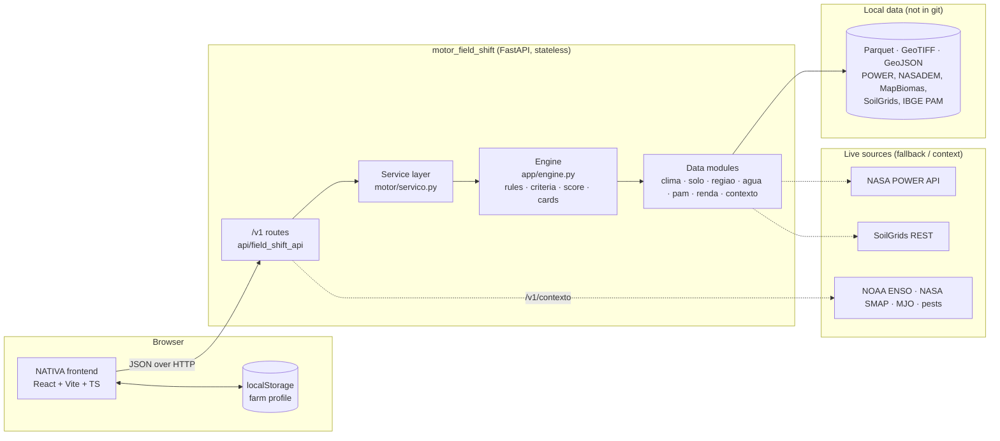
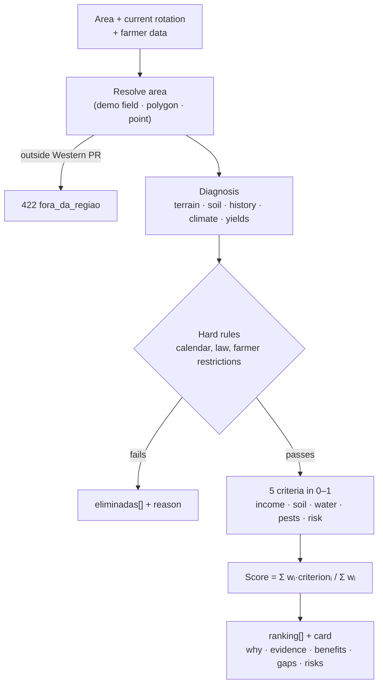

# Field Shift Brasil 🌱🛰️

**Crop-rotation decision support for Brazilian farms, built on NASA Earth observation data.**

Built for the NASA Space Apps Challenge 2026 challenge
[Field Shift: Adapting Farms with NASA Data](https://www.spaceappschallenge.org/2026/challenges/adapting-farms-with-nasa-data/).


> [!IMPORTANT]
> Field Shift **supports, but does not replace**, the advice of an agronomist. Income and risk figures are
> estimates to start a conversation with a professional. They do not replace ZARC (the official
> agricultural climate-risk zoning) or a technical recommendation.

---

## Contents

- [What it does](#what-it-does)
- [Quick start](#quick-start)
- [Architecture](#architecture)
- [How the engine scores a rotation](#how-the-engine-scores-a-rotation)
- [API](#api)
- [Data sources](#data-sources)
- [Repository layout](#repository-layout)
- [Team workflow](#team-workflow)
- [Status and roadmap](#status-and-roadmap)
- [Known limitations](#known-limitations)
- [FAQ](#faq)

---

## What it does

A farmer in Western Paraná grows soybean in summer and must decide **what to plant in the second window**
(the *safrinha* / off-season). Corn is the default choice, but it is not always the best one for soil,
water, pests or income.

Field Shift takes:

1. **An area**: a demo field, a GeoJSON polygon, or a lat/lon point.
2. **The current rotation**, for example `soja__milho_safrinha` (soybean → off-season corn).
3. **Optionally, the farmer's own data**: soil analysis, yields, prices, costs, available machinery,
   irrigation, and crops they cannot sell.

It returns:

- a **diagnosis** of the area: terrain, soil, land-use history, climate risks and municipal yields;
- a **ranking of 22 rotations** (summer crop × second-window crop). Each one has a 0–1 score, an
  estimated margin in BRL/ha, and a card that explains *why*, with evidence, benefits, gaps and risks;
- the rotations that were **ruled out** and the reason for each, such as the legal soybean-free period
  or a sowing date that falls before harvest.

<details>
<summary><b>📊 Example: real output for demo field 72638 (~104 ha, Western Paraná)</b></summary>

| Rank | Rotation | Score | Margin (BRL/ha) | Income | Soil | Water | Pests | Risk |
| ---: | --- | ---: | ---: | ---: | ---: | ---: | ---: | ---: |
| 1 | Soybean → corn + brachiaria | **0.814** | 2,116 | 0.98 | 0.71 | 0.84 | 0.65 | 0.78 |
| 2 | Soybean → off-season corn *(current)* | 0.757 | 2,076 | 0.96 | 0.56 | 0.86 | 0.50 | 0.78 |
| 3 | Soybean → millet / crotalaria (cover) | 0.756 | 994 | 0.46 | 0.82 | 1.00 | 0.70 | 1.00 |

In this case the engine finds that intercropping brachiaria with the corn keeps almost the same income
and improves soil cover and pest pressure. Full response:
[`motor_field_shift/api/exemplos/recomendacao_talhao_72638.json`](motor_field_shift/api/exemplos/recomendacao_talhao_72638.json).

</details>

---

## Quick start

You need **Python 3.13 with [uv](https://docs.astral.sh/uv/)** and **Node.js 20.19+ or 22.12+**.

```bash
git clone https://github.com/br-santella/nasa_space_apps_2026.git
cd nasa_space_apps_2026
```

<details open>
<summary><b>1. Backend: engine and API</b> → <code>http://localhost:8000/docs</code></summary>

```bash
cd motor_field_shift
uv sync
uv run uvicorn field_shift_api.main:app --app-dir api --reload
```

Check that it is up:

```bash
curl -s localhost:8000/health
# {"status":"ok","dados_carregados":true,...}
```

> [!WARNING]
> The engine reads **~280 MB of local data** from `motor_field_shift/data/raw` and `data/processed`. This
> data is **not in git**. Without it the API still starts, but `/health` reports `"degradado"` and the
> engine routes fail. Ask the team for the data bundle, or regenerate it with the scripts in
> `motor_field_shift/ingest/`. Most of them need NASA Earthdata credentials in `~/.netrc`. The full file
> list is in [`motor_field_shift/api/README.md`](motor_field_shift/api/README.md#dados-necessários-em-data).

</details>

<details open>
<summary><b>2. Frontend: NATIVA interface</b> → <code>http://localhost:5173</code></summary>

```bash
cd frontend
npm ci
npm run dev
```

Production build: `npm run build && npm run preview`. Don't open `index.html` through `file://`.

</details>

<details>
<summary><b>3. Tests</b></summary>

```bash
cd motor_field_shift
uv run pytest                  # unit tests (fake service, no data needed)
uv run pytest -m integracao    # integration tests (real service, needs the local data)

cd ../frontend
npm run build                  # type-check + production build
```

</details>

---

## Architecture



Key decisions:

| Decision | Why |
| --- | --- |
| **No user accounts or database in the MVP.** The farm profile lives in the browser and is sent with every request. | Keeps the backend stateless and the scope small enough for a 48-hour hackathon |
| **No LLM.** Hard rules, a weighted score, the FAO-56 water balance and classic statistics. Explanations are built from the computed evidence. | Every number can be traced to a source, and the tool never invents a recommendation |
| **Pre-computed regional data** with live NASA POWER / SoilGrids as fallback | Fast responses and offline demos. Today the fallbacks only fill gaps inside the region |
| **`motor_field_shift/` is the backend** | It already is a complete stateless FastAPI service. A second backend would split the team |

---

## How the engine scores a rotation



| Criterion | What it measures | Main inputs |
| --- | --- | --- |
| **Income** (`renda`) | Margin of the rotation compared with plain soybean in the municipality | IBGE PAM yields × SEAB/DERAL prices − CONAB costs |
| **Soil** (`solo`) | Straw, cover and nitrogen benefit | Crop catalog, soil texture |
| **Water** (`agua`) | Water stress in the second window | FAO-56 daily water balance, soil water capacity |
| **Pests** (`pragas`) | Pest and disease pressure, for example corn on corn | Catalog rules |
| **Risk** (`risco`) | Frost and dry-spell probability for the chosen sowing date | 30+ years of NASA POWER |

Default weights: income 5, every other criterion 3. The farmer can change them from 0 to 10.

<details>
<summary><b>Hard rules that eliminate a rotation</b></summary>

- **Soybean in the second window** is always eliminated. Soybean can only be sown from 01/09 to 31/12,
  the legal soybean-free period runs from 02/06 to 31/08, and soybean after soybean is not allowed.
- A second crop that follows the chosen sowing date must be sown **after the summer harvest**:
  soybean ~10/01, summer corn ~05/02.
- **Sowing windows:** off-season beans 15/01–28/02 and sorghum 15/01–15/03 (reference values based on
  ZARC and IDR-PR, still to be validated).
- **Farmer restrictions:** an excluded crop or no buyer for the crop.
- **Corn on corn** is *not* eliminated. It loses 0.25 on the pest criterion and gets a written risk
  warning.

</details>

---

## API

Interactive docs (Swagger with pre-filled examples) at **`http://localhost:8000/docs`**.

| Method | Route | Purpose |
| --- | --- | --- |
| `GET` | `/health` | Service status and whether data loaded (`ok` / `degradado`) |
| `GET` | `/v1/opcoes` | Crops, the 22 combinations, sowing dates, criteria, default weights, income references, demo fields |
| `GET` | `/v1/talhoes/demo` | Demo fields |
| `POST` | `/v1/diagnostico` | Full diagnosis of an area |
| `POST` | `/v1/recomendacao` | Ranked rotations, optionally with the diagnosis |
| `GET` | `/v1/clima` | Climate block only, for a point |
| `GET` `POST` | `/v1/contexto` | Current conditions (ENSO, SMAP soil moisture, MJO, pest outbreaks). Informational only: never changes the score |

<details>
<summary><b>▶ Try it: minimal recommendation</b></summary>

```bash
curl -s -X POST localhost:8000/v1/recomendacao \
  -H 'Content-Type: application/json' \
  -d '{"area": {"talhao_id": "72638"}, "rotacao_atual": "soja__milho_safrinha"}' | jq '.ranking[:3] | map({posicao, id, nota})'
```

</details>

<details>
<summary><b>▶ Try it: point, custom weights and the farmer's own data</b></summary>

```bash
curl -s -X POST localhost:8000/v1/recomendacao \
  -H 'Content-Type: application/json' \
  -d '{
    "area": {"lat": -24.95, "lon": -53.45},
    "rotacao_atual": "soja__milho_safrinha",
    "pesos": {"renda": 3, "solo": 8, "agua": 5, "pragas": 5, "risco": 5},
    "analise_solo": {"argila_pct": 65, "areia_pct": 10, "materia_organica_pct": 3.5, "ph": 5.4},
    "restricoes": {"sem_comprador": ["trigo"]},
    "irrigacao": {"disponivel": false},
    "n_alternativas": 3,
    "incluir_diagnostico": false
  }' | jq '{ranking: [.ranking[] | {id, nota, margem: .margem.total_r_ha}], eliminadas: [.eliminadas[] | {id, motivos}]}'
```

</details>

<details>
<summary><b>Error responses</b></summary>

| Status | Body | When |
| --- | --- | --- |
| 422 | `{"erro": "fora_da_regiao"}` | Area outside Western Paraná |
| 422 | validation error | Malformed request body |
| 400 | `{"erro": "entrada_invalida"}` | Invalid adjustment, or restrictions eliminated every rotation |
| 504 | `{"erro": "timeout_externo"}` | Reserved for external timeouts. Not returned yet: these failures currently come back as 500 |
| 500 | `{"erro": "interno"}` | Unexpected error |

Every engine error also carries a human-readable `mensagem`.

</details>

📄 Full field-by-field reference: [`motor_field_shift/api/README.md`](motor_field_shift/api/README.md) ·
Team contract: [`docs/contratos.md`](docs/contratos.md) ·
Mock responses: [`motor_field_shift/api/exemplos/`](motor_field_shift/api/exemplos/)

> [!NOTE]
> Field names, route names and error codes are in Portuguese because they come from the engine's code.
> The main ones: `area`, `rotacao_atual` (current rotation), `pesos` (weights), `ajustes`
> (adjustments), `restricoes` (restrictions), `eliminadas` (eliminated), `avisos` (warnings),
> `margem` (margin).

---

## Data sources

| Source | Provider | Used for | Resolution |
| --- | --- | --- | --- |
| **POWER** | NASA | Daily climate since 1991: rain, temperature, ET0, frost and dry spells | ~0.5° × 0.625° |
| **NASADEM** | NASA | Elevation and slope | 30 m |
| **SMAP** | NASA | Current soil moisture (context only) | 9 km |
| **HLS** (NDVI) | NASA / USGS | Observed rotation on the demo field | 30 m |
| MapBiomas | MapBiomas Brasil | Land-use history, 2019–2024 | 30 m |
| SoilGrids 2.0 | ISRIC | Clay, sand, organic carbon, pH, soil water capacity | 250 m |
| PAM | IBGE | Municipal crop yields | Municipality |
| Prices and costs | SEAB/DERAL, CONAB | Margin estimates | State / reference |
| INMET | INMET | Validation of POWER climate | Weather stations |
| ENSO, MJO | NOAA | Current climate context | Global |

More detail: [`motor_field_shift/docs/datasets.md`](motor_field_shift/docs/datasets.md).

---

## Repository layout

```text
.
├── motor_field_shift/          ← backend: engine + FastAPI (Python, uv)
│   ├── api/                    routes, Pydantic schemas, tests, real response examples
│   ├── src/field_shift/
│   │   ├── motor/              service layer: diagnosticar(), recomendar(), opcoes()
│   │   ├── app/                engine: hard rules, criteria, score, explanation cards
│   │   ├── clima/ solo/ agua/  climate, soil, FAO-56 water balance
│   │   ├── regiao/ pam/ renda/ region clipping, IBGE yields, income
│   │   └── contexto/           ENSO, SMAP, MJO, pest alerts
│   ├── ingest/  scripts/       data download and pre-processing
│   ├── data/                   local data (raw/ and processed/ are git-ignored)
│   └── docs/                   engine logic, data architecture, open issues
├── frontend/                   NATIVA interface (React 19 + Vite + TypeScript)
├── catalog/                    crops.yaml + vocabulario.yaml: agronomic catalog with sources
└── docs/                       team contracts, pitch material
```

---

## Team workflow

| # | Workstream | Main folders |
| --- | --- | --- |
| 1 | Data | `motor_field_shift/ingest/`, `scripts/`, `data/`, `src/field_shift/{clima,solo,regiao,agua,pam,renda,contexto}/` |
| 2 | Agronomic curation | `catalog/` |
| 3 | Scoring engine | `motor_field_shift/src/field_shift/{motor,app}/` |
| 4 | Confidence, explanations, API | `motor_field_shift/api/`, engine cards and warnings |
| 5 | Frontend | `frontend/` |
| 6 | Product, integration, pitch | `docs/`, deploy |

Every task gets a short-lived branch from `main` and goes in through a pull request:

```bash
git checkout main && git pull
git checkout -b feat/<topic>        # or fix/<topic>, chore/<topic>, docs/<topic>
# ...work, small commits...
git push -u origin feat/<topic>
gh pr create --base main
```

> [!TIP]
> - Never commit directly to `main`.
> - Merge `main` into your branch often (`git merge main`) to keep conflicts small.
> - **Contracts first:** if you change something in [`docs/contratos.md`](docs/contratos.md), tell the
>   team and update the file in the same PR.
> - Unit tests use a fake service. **Run `uv run pytest -m integracao` with the real data** before merging
>   engine changes.
> - Never commit keys, credentials, `.env` or `.netrc`.

---

## Status and roadmap

**Deadline: 15/11/2026, 23:59.** Feature freeze at 18:00.

- [x] Scoring engine with 22 rotations, hard rules and explanation cards
- [x] FastAPI with diagnosis, recommendation, climate and context routes
- [x] NATIVA frontend with demo flows
- [x] Crop catalog (summer and winter crops) with sources
- [x] Live NASA POWER / SoilGrids fallback code (inside the region only)
- [ ] Nationwide coverage: remove the region lock and wire the fallbacks for any area in Brazil
- [ ] **Frontend calls the API** instead of the demo data in `frontend/src/data.ts`
- [ ] Demo farm moved to Western Paraná (it is currently in Sorriso, MT)
- [ ] Confidence traffic light: 🔴 see a professional · 🟡 indicative · 🟢 well supported
- [ ] Engine reads `catalog/crops.yaml`, so there is one source of crop data
- [ ] Data bundle shared with the whole team
- [ ] Deploy and pitch

---

## Known limitations

| Limitation | Impact |
| --- | --- |
| **Region:** only Western Paraná (50 municipalities, IBGE 4106) | Any other area returns 422 |
| **Climate cells are ~50 km** (NASA POWER) | Local microclimate is not captured |
| **Soil water capacity** uses Saxton & Rawls (2006), calibrated on temperate soils | Tends to underestimate it in clay-rich tropical Latosols. A farmer soil analysis replaces it |
| **Income** uses municipal averages and reference prices | Real margins vary by farm; the farmer can override yields, prices and costs |
| **MapBiomas** history only covers 2019–2024 | Older land use is not considered |
| Several agronomic coefficients are **estimates still to be validated** | They are marked as estimates in the response |

---

## FAQ

<details>
<summary><b>Why is there no login?</b></summary>

The MVP has no user accounts. The sign-up screens in the frontend only save a local profile in the
browser. This keeps the backend stateless. Accounts can be added later as a thin layer in front of the
engine, without touching the scoring.

</details>

<details>
<summary><b>Where is the "AI" if there is no LLM?</b></summary>

The intelligence is in the data pipeline and the decision model: NDVI time series to detect the rotation
actually used on a field, a daily FAO-56 water balance, climate-risk statistics from 30+ years of
satellite-derived data, and multi-criteria ranking. Every explanation is built from computed evidence,
so the tool never makes up an answer.

</details>

<details>
<summary><b><code>/health</code> says <code>degradado</code>. What now?</b></summary>

The local data is missing. The `detalhe` field names the first file that was not found. Get the data
bundle from the team or run the ingestion scripts. See the
[data list](motor_field_shift/api/README.md#dados-necessários-em-data).

</details>

<details>
<summary><b>Can I test the frontend without the backend data?</b></summary>

Yes. Use the real responses in [`motor_field_shift/api/exemplos/`](motor_field_shift/api/exemplos/) as
mocks. They have exactly the shape the API returns.

</details>
