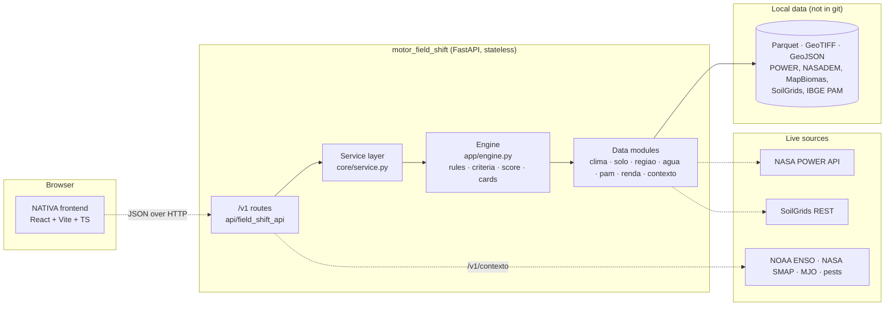
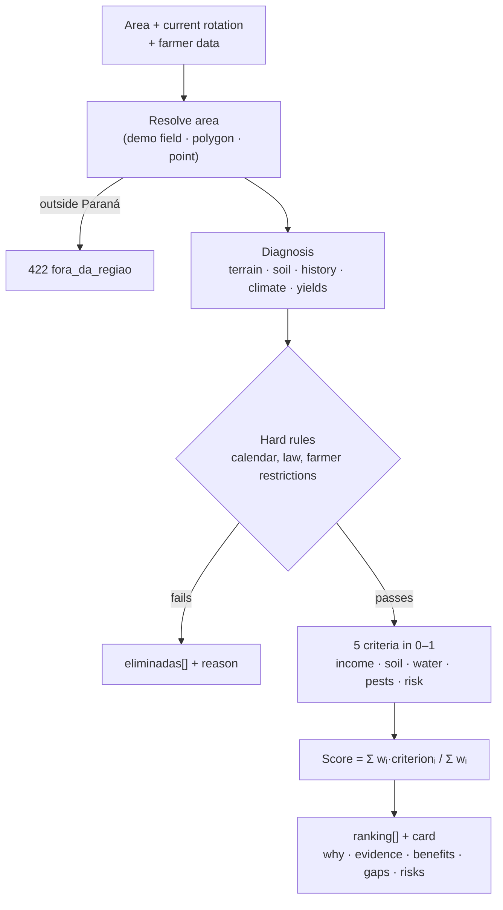

# Field Shift Brasil 🌱🛰️

**Crop-rotation decision support for Brazilian farms, built on NASA Earth observation data.**

Developed for the NASA Space Apps Challenge 2026 challenge
[Field Shift: Adapting Farms with NASA Data](https://www.spaceappschallenge.org/2026/challenges/adapting-farms-with-nasa-data/).


-2E7D32)

> [!IMPORTANT]
> Field Shift does not replace the advice of an agronomist. Income and risk figures are estimates. They
> do not replace ZARC (the official agricultural climate-risk zoning) or a technical recommendation.

---

## Contents

- [Overview](#overview)
- [Quick start](#quick-start)
- [Architecture](#architecture)
- [Scoring](#scoring)
- [API](#api)
- [Data sources](#data-sources)
- [Repository layout](#repository-layout)
- [Contributing](#contributing)
- [Limitations](#limitations)
- [FAQ](#faq)

---

## Overview

Field Shift ranks crop rotations for a field anywhere in Paraná (399 municipalities; the pilot is Western Paraná, and the income and risk backtests were repeated for all of Paraná: `motor_field_shift/docs/validation.md` §7). A rotation is a pair: a summer crop
(soybean or summer corn) followed by a second-window crop (the *safrinha* / off-season).

**Inputs**

1. **An area**: a demo field id, a GeoJSON polygon, or a lat/lon point.
2. **The current rotation**, for example `soja__milho_safrinha` (soybean → off-season corn).
3. **Optional farmer data**: soil analysis, yields, prices, costs, available machinery, irrigation, and
   crops without a buyer.

**Outputs**

- a **diagnosis** of the area: terrain, soil, land-use history, climate risks and municipal yields;
- a **ranking of up to 22 rotations**. Each one has a 0–1 score, an estimated margin in BRL/ha, and a
  card with the reasons, evidence, benefits, data gaps and risks;
- the **eliminated rotations**, each with the rule that eliminated it.

<details>
<summary><b>📊 Example output for demo field 72638 (~104 ha)</b></summary>

| Rank | Rotation | Score | Margin (BRL/ha) | Income | Soil | Water | Pests | Risk |
| ---: | --- | ---: | ---: | ---: | ---: | ---: | ---: | ---: |
| 1 | Soybean → corn + brachiaria | **0.798** | 2,994 | 0.93 | 0.71 | 0.81 | 0.65 | 0.80 |
| 2 | Soybean → millet / crotalaria (cover) | 0.756 | 1,103 | 0.46 | 0.82 | 1.00 | 0.70 | 1.00 |
| 3 | Soybean → off-season corn *(current)* | 0.755 | 2,954 | 0.92 | 0.56 | 0.83 | 0.50 | 0.86 |

Each option also carries its uncertainty (`incerteza`): for corn + brachiaria the income ranges from BRL 60 to 2,943/ha across the last 5 seasons, and the score from 0.68 to 0.818. Repeating each of those seasons, corn + brachiaria would be first in 4 of 5 (`estabilidade`).

Full response:
[`motor_field_shift/api/exemplos/recomendacao_talhao_72638.json`](motor_field_shift/api/exemplos/recomendacao_talhao_72638.json).

</details>

---

## Quick start

Requirements: **Python 3.13 with [uv](https://docs.astral.sh/uv/)** and **Node.js 20.19+ or 22.12+**.

```bash
git clone https://github.com/br-santella/nasa_space_apps_2026.git
cd nasa_space_apps_2026
```

<details open>
<summary><b>1. Backend: engine and API</b> → <code>http://localhost:8000/docs</code></summary>

```bash
cd motor_field_shift
uv sync
uv run uvicorn field_shift_api.main:app --app-dir api --reload
```

Health check:

```bash
curl -s localhost:8000/health
# {"status":"ok","dados_carregados":true,...}
```

> [!WARNING]
> The engine reads **~280 MB of local data** from `motor_field_shift/data/raw` and `data/processed`. This
> data is not in git. Without it the API starts, `/health` reports `"degradado"`, and the engine routes
> return errors. The data is generated by the scripts in `motor_field_shift/ingest/`. Most of them
> require NASA Earthdata credentials in `~/.netrc`. File list:
> [`motor_field_shift/api/README.md`](motor_field_shift/api/README.md#dados-necessários-em-data).

</details>

<details open>
<summary><b>2. Frontend: NATIVA interface</b> → <code>http://localhost:5173</code></summary>

```bash
cd frontend
npm ci
npm run dev
```

Production build: `npm run build && npm run preview`. The built `index.html` must be served over HTTP, not
opened through `file://`

The frontend uses the demo data in `frontend/src/data.ts`. It does not call the API.

</details>

<details>
<summary><b>3. Tests</b></summary>

```bash
cd motor_field_shift
uv run pytest                  # unit tests (fake service, no data needed)
uv run pytest -m integration    # integration tests (real service, requires the local data)

cd ../frontend
npm run build                  # type-check + production build
```

</details>

---

## Architecture



| Component | Description |
| --- | --- |
| **API** | Stateless FastAPI service. No authentication and no user database: every request carries all the data needed for the calculation |
| **Engine** | Hard rules, five scoring criteria, a weighted score, and explanation cards built from the computed values. No language model is used |
| **Data** | Pre-computed regional files read from disk. NASA POWER and SoilGrids are queried live when a local file does not cover an area inside the region |
| **Context** | `/v1/contexto` queries current-condition sources at request time and caches the results in `data/cache_contexto/` |

---

## Scoring



| Criterion | What it measures | Main inputs |
| --- | --- | --- |
| **Income** (`renda`) | Margin of the rotation compared with plain soybean in the municipality | IBGE PAM yields × SEAB/DERAL prices − CONAB costs |
| **Soil** (`solo`) | Straw, cover and nitrogen benefit | Crop catalog, soil texture |
| **Water** (`agua`) | Water stress in the second window | FAO-56 daily water balance, soil water capacity |
| **Pests** (`pragas`) | Pest and disease pressure, for example corn on corn | Catalog rules |
| **Risk** (`risco`) | Frost and dry-spell probability for the chosen sowing date | NASA POWER, 1991 onwards |

Default weights: income 5, all other criteria 3. Accepted range: 0 to 10 per criterion. If every weight
is 0, the engine uses equal weights.

<details>
<summary><b>Hard rules</b></summary>

- **Soybean in the second window** is always eliminated. Soybean sowing is allowed from 01/09 to 31/12,
  the legal soybean-free period runs from 02/06 to 31/08, and soybean after soybean is not allowed.
- A second crop that follows the chosen sowing date must be sown **after the summer harvest**
  (reference harvest dates: soybean ~10/01, summer corn ~05/02).
- **Sowing windows:** off-season beans 15/01–28/02, sorghum 15/01–15/03 (reference values based on ZARC
  and IDR-PR).
- **Farmer restrictions:** excluded crops and crops without a buyer.
- **Corn on corn** is not eliminated. It receives −0.25 on the pest criterion and a risk warning on the
  card.

</details>

---

## API

Interactive documentation (Swagger, with pre-filled examples): **`http://localhost:8000/docs`**.

| Method | Route | Description |
| --- | --- | --- |
| `GET` | `/health` | Service status and whether the data loaded (`ok` / `degradado`) |
| `GET` | `/v1/opcoes` | Crops, the 22 combinations, sowing dates, criteria, default weights, income references, demo fields |
| `GET` | `/v1/talhoes/demo` | Demo fields |
| `POST` | `/v1/diagnostico` | Full diagnosis of an area |
| `POST` | `/v1/recomendacao` | Ranked rotations, optionally with the diagnosis |
| `GET` | `/v1/clima` | Climate block only, for a point |
| `GET` `POST` | `/v1/contexto` | Current conditions (ENSO, SMAP soil moisture, MJO, pest outbreaks). Informational: does not change the score |

Responses are in **Brazilian Portuguese by default** and in **English** with `?lang=en` or `Accept-Language: en`
(`lang` wins over the header; the answer says which one in `Content-Language`). Only the texts change: keys, ids, enums and
numbers are the same in both languages. See [`motor_field_shift/api/README.md`](motor_field_shift/api/README.md#response-language-lang).

<details>
<summary><b>▶ Example: minimal recommendation</b></summary>

```bash
curl -s -X POST localhost:8000/v1/recomendacao \
  -H 'Content-Type: application/json' \
  -d '{"area": {"talhao_id": "72638"}, "rotacao_atual": "soja__milho_safrinha"}' | jq '.ranking[:3] | map({posicao, id, nota})'
```

</details>

<details>
<summary><b>▶ Example: point, custom weights and farmer data</b></summary>

```bash
curl -s -X POST localhost:8000/v1/recomendacao \
  -H 'Content-Type: application/json' \
  -d '{
    "area": {"lat": -24.95, "lon": -53.45},
    "rotacao_atual": "soja__milho_safrinha",
    "pesos": {"renda": 3, "solo": 8, "agua": 5, "pragas": 5, "risco": 5},
    "analise_solo": {"argila_pct": 65, "areia_pct": 10, "materia_organica_pct": 3.5, "ph": 5.4},
    "restricoes": {"sem_comprador": ["trigo"]},
    "irrigacao": {"disponivel": false},
    "n_alternativas": 3,
    "incluir_diagnostico": false
  }' | jq '{ranking: [.ranking[] | {id, nota, margem: .margem.total_r_ha}], eliminadas: [.eliminadas[] | {id, motivos}]}'
```

</details>

<details>
<summary><b>Error responses</b></summary>

| Status | Body | When |
| --- | --- | --- |
| 422 | `{"erro": "fora_da_regiao"}` | Area outside Paraná |
| 422 | validation error | Malformed request body |
| 400 | `{"erro": "entrada_invalida"}` | Invalid adjustment, or restrictions eliminated every rotation |
| 504 | `{"erro": "timeout_externo"}` | Raised on `ErroConsultaExterna`. Failures of the NASA POWER and SoilGrids clients are handled inside those clients and do not raise it |
| 500 | `{"erro": "interno"}` | Unexpected error |

Every engine error includes a human-readable `mensagem`.

</details>

References: [`motor_field_shift/api/README.md`](motor_field_shift/api/README.md) (field-by-field) ·
[`docs/contratos.md`](docs/contratos.md) (contracts) ·
[`motor_field_shift/api/exemplos/`](motor_field_shift/api/exemplos/) (real responses)

> [!NOTE]
> Field names, routes and error codes are in Portuguese, as defined in the engine code. Main terms:
> `area`, `rotacao_atual` (current rotation), `pesos` (weights), `ajustes` (adjustments), `restricoes`
> (restrictions), `eliminadas` (eliminated), `avisos` (warnings), `margem` (margin).

---

## Data sources

| Source | Provider | Used for | Resolution |
| --- | --- | --- | --- |
| **POWER** | NASA | Daily climate since 1991: rain, temperature, ET0, frost and dry spells | ~0.5° × 0.625° |
| **NASADEM** | NASA | Elevation and slope | 30 m |
| **SMAP** | NASA | Current soil moisture (context only) | 9 km |
| **HLS** (NDVI) | NASA / USGS | Observed rotation on demo field 72638 | 30 m |
| MapBiomas | MapBiomas Brasil | Land-use history, 2019–2024 | 30 m |
| SoilGrids 2.0 | ISRIC | Clay, sand, organic carbon, pH, soil water capacity | 250 m |
| PAM | IBGE | Municipal crop yields | Municipality |
| Prices and costs | SEAB/DERAL, CONAB | Margin estimates | State / reference |
| INMET | INMET | Validation of POWER climate | Weather stations |
| ENSO, MJO | NOAA | Current climate context | Global |

Details: [`motor_field_shift/docs/datasets.md`](motor_field_shift/docs/datasets.md).

---

## Repository layout

```text
.
├── motor_field_shift/          backend: engine + FastAPI (Python, uv)
│   ├── api/                    routes, Pydantic schemas, tests, real response examples
│   ├── src/field_shift/
│   │   ├── core/               service layer: diagnose(), recommend(), options()
│   │   ├── app/                engine: hard rules, criteria, score, explanation cards
│   │   ├── climate/ soil/ water/  climate, soil, FAO-56 water balance
│   │   ├── region/ pam/ income/   region clipping, IBGE yields, income
│   │   ├── context/            ENSO, SMAP, MJO, pest alerts
│   │   └── i18n/               English translation of the API responses (pt-BR is the default)
│   ├── ingest/  scripts/       data download and pre-processing
│   ├── data/                   local data (raw/ and processed/ are git-ignored)
│   └── docs/                   engine logic, data architecture
├── frontend/                   NATIVA interface (React 19 + Vite + TypeScript)
├── catalog/                    crops.yaml + vocabulario.yaml: agronomic catalog with sources
└── docs/                       contracts between backend, catalog and frontend
```

---

## Contributing

Changes go into `main` through pull requests from short-lived branches:

```bash
git checkout main && git pull
git checkout -b feat/<topic>        # or fix/<topic>, chore/<topic>, docs/<topic>
git push -u origin feat/<topic>
gh pr create --base main
```

> [!TIP]
> - Changes to a contract in [`docs/contratos.md`](docs/contratos.md) update that file in the same PR.
> - Unit tests use a fake service. Engine changes are validated with `uv run pytest -m integration` and
>   the local data.
> - Keys, credentials, `.env` and `.netrc` are not committed.

---

## Limitations

| Limitation | Effect |
| --- | --- |
| **Region:** Paraná (399 municipalities); prices/costs are state references, sowing windows and market texts come from Western Paraná; outside it the cover crop still ranks first more often (71 % of municipalities, on soil and pests) although it lost to off-season corn on realized income; the card states the income given up (`docs/validation.md` §7) | An area outside Paraná returns 422; outside Western Paraná the response warns |
| **Climate cells of ~50 km** (NASA POWER) | Local microclimate is not represented |
| **Soil water capacity** from Saxton & Rawls (2006), calibrated on temperate soils | Tends to underestimate it in clay-rich tropical Latosols. A farmer soil analysis replaces it |
| **Income** from municipal averages and reference prices | Farm margins differ; yields, prices and costs can be overridden in the request |
| **MapBiomas** history covers 2019–2024 | Earlier land use is not considered |
| Agronomic coefficients marked as estimates | Flagged as `estimativa` in the response |
| **Catalog:** the engine uses its internal crop list | `catalog/crops.yaml` is not read by the engine. Valid ids are the ones returned by `/v1/opcoes` |

---

## FAQ

<details>
<summary><b>Is there a login?</b></summary>

No. The API has no accounts or user storage. The sign-up screens in the frontend keep the data in the
browser session only.

</details>

<details>
<summary><b>What techniques does the engine use?</b></summary>

NDVI time series to detect the rotation observed on a field, a daily FAO-56 water balance, climate-risk
statistics from NASA POWER, and multi-criteria weighted ranking. Explanation cards are assembled from the
computed values. No language model is used.

</details>

<details>
<summary><b><code>/health</code> reports <code>degradado</code></b></summary>

The local data is missing. The `detalhe` field names the first file that was not found. See the
[data list](motor_field_shift/api/README.md#dados-necessários-em-data).

</details>

<details>
<summary><b>Can the frontend be developed without the backend data?</b></summary>

Yes. The files in [`motor_field_shift/api/exemplos/`](motor_field_shift/api/exemplos/) are real API
responses and can be used as mocks.

</details>
