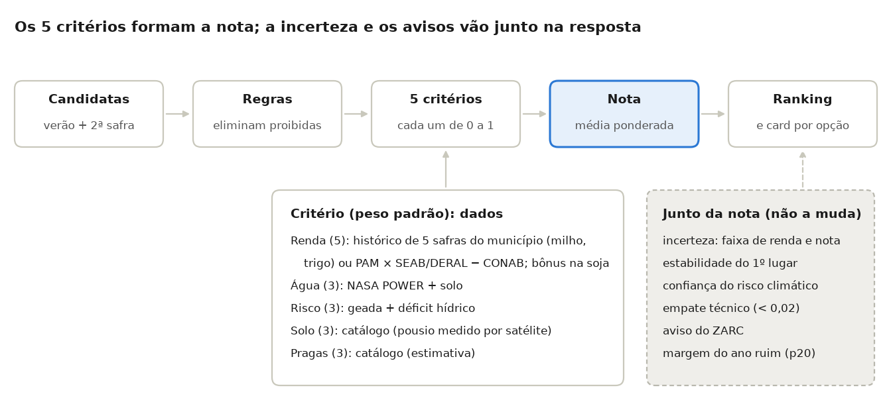

# Field Shift — Como o motor calcula cada fator

15/11/2026 · Lucas Cordeiro · cópia do doc compartilhado: <https://claude.ai/artifact/1VYum3DyFYLYcdgeuNniQs>. Detalhes técnicos e código: [`motor.md`](motor.md).

## Visão geral

Cada rotação candidata (cultura de verão + 2ª safra) recebe uma nota de 0 a 1, que é a média ponderada de 5 critérios, depois de passar pelas regras que eliminam opções proibidas.

$$\text{nota} = \frac{\sum_i w_i \cdot c_i}{\sum_i w_i}$$

| Critério | Peso padrão | O que mede | Dados principais |
| --- | --- | --- | --- |
| Renda | 5 | Quanto a 2ª safra soma à margem da soja do município | Histórico de 5 safras do município ou IBGE PAM, SEAB/DERAL, CONAB |
| Água | 3 | Quanto da demanda de água da cultura o solo atende na fase crítica | NASA POWER, SoilGrids |
| Risco climático | 3 | Chance de geada e de déficit hídrico na fase crítica | NASA POWER, SoilGrids |
| Saúde do solo | 3 | Cobertura, fixação de N e dias de solo descoberto; com análise do produtor, também acidez, P/K e matéria orgânica | Catálogo (estimativa; pousio medido por satélite); Manual PR e Embrapa |
| Quebra de pragas | 3 | Quanto a 2ª safra quebra o ciclo de pragas e doenças | Catálogo (estimativa) |

Cada critério fica numa escala absoluta de 0 a 1 (não é reescalado entre as candidatas), para que diferenças pequenas não pareçam grandes. O produtor pode mudar os pesos. Junto da nota, sem mudá-la, a resposta traz o aviso do ZARC, o empate técnico e a incerteza de cada opção (faixa de renda e de nota, estabilidade do 1º lugar e confiança do risco climático; ver o exemplo no fim e [`precisao_do_motor.md`](precisao_do_motor.md)).

## Regras que eliminam e avisos

Antes da nota, o motor elimina o que é proibido ou inviável no calendário; a opção eliminada aparece na resposta com o motivo.

| Regra | Efeito |
| --- | --- |
| Vazio sanitário da soja (ADAPAR, por região do PR; Oeste: 02/06 a 31/08) | Elimina |
| Soja só dentro da janela de semeadura da região (Oeste: 01/09 a 31/12) | Elimina |
| Soja sobre soja no mesmo ano agrícola (Portaria SDA/MAPA 1.124/2024) | Elimina |
| Semear a 2ª safra antes da colheita do verão | Elimina |
| Colheita do verão depois de 15/03 (tarde demais para 2ª safra de grão) | Elimina as culturas que seguem a data; trigo, aveia, nabo e pousio ficam |
| Fora da janela da cultura (feijão 15/01 a 28/02; sorgo 15/01 a 15/03) | Elimina |
| Milho sobre milho (milho verão + milho safrinha) | Não elimina: tira 0,25 do critério de pragas e avisa da cigarrinha |
| Fora do ZARC no município e na data | Não elimina nem muda a nota: o card avisa que não há crédito rural subsidiado, Proagro nem seguro |

Na prática, soja na 2ª safra é sempre eliminada. As restrições do produtor (sem máquina, sem comprador, culturas excluídas) também eliminam ou somam custo de terceirização.

## Renda

A renda mede quanto a 2ª safra (mais o bônus na soja seguinte) soma à margem da soja do município, numa régua S que é a mesma em todo o Paraná.

$$\text{renda} = 0{,}5 + 0{,}5 \cdot \tanh\left(\frac{\text{incremental}}{S}\right)$$

- **Incremental** = margem da rotação − margem da soja = margem da 2ª safra + bônus na soja seguinte (+ diferença verão − soja, se o verão for milho).
- **Margem da 2ª safra:**
  - **Milho safrinha, milho + braquiária e trigo:** média da margem realizada nas últimas 5 safras do município, em sacas de soja/ha × preço da soja. Em safras que o modelo não viu, isso escolheu melhor que a estimativa a preço atual em 13 de 16 safras (+1,26 saca/ha/ano).
  - **Quando o produtor informa preço, custo ou produtividade dessa cultura, e nas demais culturas:** produtividade esperada × preço − custo (tabela abaixo).
- **S** = R$ 1.110/ha em todo o Paraná: a margem mediana da soja nos 50 municípios do Oeste, onde o motor foi validado. Antes era a margem da soja de cada município, e onde a soja rende mais (Centro-Sul, Campos Gerais) o mesmo real de milho pesava até 3 vezes menos. Incremental zero dá 0,5; +S dá 0,88; −S dá 0,12. A nota nunca chega a 0 ou 1, então duas opções boas não empatam no teto (antes a fórmula cortava em 1,0 e os dois milhos ficavam iguais).

| Componente | Como é calculado | Fonte |
| --- | --- | --- |
| Produtividade esperada | Tendência linear dos últimos 10 anos do município, projetada para a próxima safra e limitada ao mínimo–máximo desses anos. Sem dado municipal: média do Oeste do PR | IBGE PAM |
| Ano ruim | Percentil 20 dos mesmos 10 anos (nunca acima da esperada); aparece no card, não entra na nota | IBGE PAM |
| Preço | Média dos últimos 12 meses do preço recebido pelo produtor no Paraná. Sorgo: 75 % do milho (razão dos preços mínimos, estimativa). Feijão: tipo preto | SEAB/DERAL-PR |
| Custo | Custo variável (≈ COE) da planilha CONAB de Londrina (soja, milho safrinha), Ponta Grossa (trigo, milho verão), Francisco Beltrão (feijão), Rio Verde-GO (sorgo). Fertilizante, transporte e armazenagem são ajustados à produtividade local | CONAB |
| Coberturas e pousio | Só custo de implantação: aveia R$ 375, milheto/crotalária R$ 450, nabo R$ 275, aveia + nabo R$ 400, braquiária em consórcio R$ 200, pousio R$ 200 por ha | Estimativa de referência |
| Bônus na soja seguinte | Sacas/ha a mais na soja seguinte × preço da soja (ex.: milho + braquiária 3 sc, milho safrinha 1 sc) | Catálogo (estimativa) |

O produtor pode informar preço, custo e produtividade próprios, que substituem as referências. Por usar S, a nota depende da **relação** entre o preço da 2ª cultura e o da soja: se os dois sobem juntos, ela muda pouco.

**Histórico de 5 safras:** para milho safrinha, milho + braquiária e trigo, o motor calcula a margem realizada nas últimas 5 safras do município. Cada safra usa a produtividade daquele ano, o preço realizado do Paraná naquele ano (valor ÷ produção, IBGE PAM) e o custo CONAB daquele ano. Tudo é convertido em sacas de soja/ha, para comparar anos com preços diferentes. A média entra na nota; cada safra aparece no card e em `historico_renda`; a pior e a melhor dão a faixa de renda em `incerteza`.

## Água

A água é a fração média da demanda de água da cultura que o solo conseguiu atender na fase crítica, nos 34 anos de 1991 a 2024.

$$\text{água} = \frac{1}{34}\sum_{\text{anos}} \frac{\sum \text{ETa}}{\sum \text{ETc}}\Big|_{\text{fase crítica}}$$

- **ETc** é quanto a cultura gastaria sem falta de água (ET0 × Kc da fase). **ETa** é quanto ela conseguiu gastar com a água disponível no solo.
- **Balanço hídrico diário (FAO-56):** a cada dia entra a chuva e sai a evapotranspiração; o solo funciona como um balde do tamanho da capacidade de água disponível (CAD) até a profundidade da raiz (0,6 a 0,8 m). Quando o balde esvazia além de 55 % (45 % no feijão), a planta passa a transpirar menos.
- **Clima:** chuva diária e ET0 (Penman-Monteith) da NASA POWER, célula de ~50 km do talhão.
- **Solo:** CAD do polígono calculada da textura do SoilGrids (pedotransferência de Saxton & Rawls), ou da análise de solo do produtor quando ele envia.
- **Data de semeadura:** a escolhida (ou derivada da colheita do verão); trigo e aveia em 01/05.

| Cultura | Fase crítica |
| --- | --- |
| Milho safrinha (com ou sem braquiária) | Do 55º ao 95º dia após a semeadura (florescimento e enchimento) |
| Trigo | Espigamento e enchimento (60º ao 100º dia) |
| Sorgo | Emborrachamento ao enchimento (50º ao 90º dia) |
| Feijão | Florescimento e formação de vagens (30º ao 65º dia) |
| Coberturas | Estabelecimento (primeiros 30 dias) |
| Pousio | Sem demanda: 1,0 |

Com irrigação informada, o balanço repõe a água quando o solo esvazia; o critério sobe e o custo da lâmina sai da renda.

## Risco climático

O risco é a chance de nenhum evento climático ruim acontecer na fase sensível da cultura, contada nos 34 anos de clima (1991–2024).

$$\text{risco} = \prod_i (1 - p_i)$$

Cada pᵢ é a fração dos anos em que o evento aconteceu; o produto supõe eventos independentes. A perda prevista é 1 − risco. Sem risco relevante (coberturas, pousio), o critério vale 1,0.

| Evento | Definição | Culturas |
| --- | --- | --- |
| Geada no safrinha | Temperatura mínima ≤ 3 °C do 60º ao 120º dia após a semeadura (florescimento/enchimento) | Milho, milho + braquiária; sorgo e feijão pela mesma janela, como aproximação |
| Geada no trigo | Temperatura mínima ≤ 3 °C de 15/08 a 30/09 | Trigo |
| Déficit hídrico | Anos em que a água atendeu menos de 55 % da demanda na fase crítica (mesmo balanço do critério de água, com o solo do talhão e a data escolhida) | Milho, milho + braquiária, feijão, soja safrinha |

- **Por que 55 %:** no histórico do Oeste, o milho safrinha quebrou em 65 % dos anos abaixo desse limite e em 20 % dos demais, e com ele o risco do motor concorda melhor com o ZARC. O indicador anterior (veranico de 15 dias sem chuva em março–abril) não previa quebra nenhuma.
- **Quanto confiar:** a perda prevista acerta a média (24 % contra 23 % de quebras observadas), mas não diz qual safra vai quebrar. Testamos também calor na floração e chuva na colheita: o modelo acertou mais nas safras usadas para ajustá-lo e errou mais nas que não viu (overfitting), por isso não entrou. A resposta marca a confiança do risco do milho safrinha como "baixa".
- **Sem dado de solo:** o déficit volta a ser o veranico da célula.
- **Irrigado:** o déficit não conta; a geada continua.
- **Sorgo:** tolerante à seca, só conta geada.

A data de semeadura pesa muito no milho safrinha. No talhão 72638, a geada na fase crítica vai de 6 % dos anos (semeadura em 15/01) a 76 % (15/03).

## Saúde do solo e quebra de pragas

Os dois critérios vêm de atributos do catálogo de cada 2ª safra: são estimativas de referência, ainda a validar com agrônomo e Embrapa.

$$\text{solo} = \frac{\text{cobertura} + \text{fixação de N} + \left(1 - \frac{\text{dias descobertos}}{180}\right)}{3}$$

- **Cobertura** (0 a 1): quanto de palha a cultura deixa para proteger o solo.
- **Fixação/ciclagem de N** (0 a 1): quanto de nitrogênio fica para a soja seguinte (crotalária alto, milho baixo).
- **Dias de solo descoberto por ano:** ex.: milho safrinha ~60, milho + braquiária ~30, pousio ~90. O pousio vem da medição por satélite (NDVI do NASA HLS em 335 talhões ao redor do 72638): ~31 dias a mais que o milho por ano. Antes o catálogo usava 150, e a diferença de 90 dias era ~3 vezes a medida.

**Quebra de pragas** = nota de 0 a 1 do catálogo para o quanto a 2ª safra interrompe o ciclo de pragas e doenças da soja (ex.: milheto/crotalária 0,70; milho + braquiária 0,65; milho safrinha 0,50; pousio e feijão 0,30). Milho sobre milho tira 0,25.

**Estado da área (opcional):** se o produtor informa problemas (nematoide, mofo-branco, cigarrinha, compactação), cada par problema × cultura com fonte lida move pragas (ou solo, na compactação) em ±0,15. A análise de fertilidade (P, K, V %…) soma o custo de correção à renda, pelo Manual de Adubação e Calagem do Paraná. Sem essas entradas, nada disso entra na nota.

**Fertilidade e matéria orgânica no critério solo (com fonte):**

| Condição do solo informada | Favorece (+0,15) | Penaliza (−0,15) | Fonte |
|---|---|---|---|
| Solo ácido (Al médio/alto ou V % baixo; metade com severidade 1) | — | milho, milho + braquiária, trigo, feijão, sorgo, soja safrinha | Manual PR (SENAR PR.0404): classe de tolerância à acidez "baixa" |
| P ou K baixos | milho + braquiária, nabo forrageiro | — | Resende et al. 2021 (Embrapa, até 40 kg/ha de K2O reciclado); Betta et al. 2008; Viola et al. 2013 |
| Matéria orgânica baixa (C ≤ 8 g/dm³, MO ≤ ~1,4 %; classes do Manual PR) | milho + braquiária, milheto/crotalária | pousio | Resende et al. 2021 (MO sobe em 9 anos, não em um ciclo); Bertin et al. 2005 |

O tamanho (±0,15) é escolha de modelagem; a direção tem fonte lida. Sem fonte, o efeito é neutro e o card avisa. Os ajustes **não saturam**: somam com inclinação 1 perto de zero e se aproximam de 1 (ou 0) sem chegar, como a renda com tanh. Antes, num solo degradado o milheto/crotalária batia em 1,00 e empatava com o milho + braquiária (0,753); agora fica milho + braquiária 0,781 (solo 0,898) e milheto/crotalária 0,744 (solo 0,965).

**Quanto custa recuperar o solo** (card e campo `recuperacao_solo`): calagem da área inteira de uma vez + adubação P/K extra da cultura + renda que deixa de ganhar frente à opção de maior renda. No 72638 degradado: milho + braquiária ≈ R$ 1.310/ha no 1º ano (calagem 901 + P/K 409; crédito de até R$ 200/ha em K2O reciclado), milheto/crotalária ≈ R$ 1.987/ha (calagem 901 + R$ 1.086 de renda abdicada).

## Exemplo: talhão 72638, milho + braquiária

No talhão 72638 (Toledo, 104 ha), com semeadura em 01/02 e pesos padrão, a soja → milho safrinha + braquiária fica em 1º lugar com nota 0,799.

**Renda** (S = R$ 1.110/ha, a mesma no Paraná todo; soja a R$ 120,14/sc):

| Item | Valor |
| --- | --- |
| Margem realizada do milho + braquiária, últimas 5 safras (já desconta a braquiária) | média 8,7 sc de soja/ha × R$ 120,14 = R$ 1.045/ha |
| Bônus na soja seguinte | 3 sc × R$ 120,14 = R$ 360/ha |
| **Incremental** | **R$ 1.406/ha** |
| A preço atual seria | 1.641 (milho) − 200 (braquiária) + 360 = R$ 1.802/ha |

Renda = 0,5 + 0,5 × tanh(1.406 ÷ 1.110) = **0,926**.

Na estimativa a preço atual, o milho de Toledo daria 117 sc/ha × R$ 53,89 − R$ 4.678 = R$ 1.641/ha. O histórico realizado é mais baixo porque inclui 2021, quando a safra quebrou.

**Nota final:**

| Critério | Peso | Valor | Peso × valor |
| --- | --- | --- | --- |
| Renda | 5 | 0,926 | 4,63 |
| Saúde do solo | 3 | 0,711 | 2,13 |
| Água | 3 | 0,844 | 2,53 |
| Quebra de pragas | 3 | 0,650 | 1,95 |
| Risco climático | 3 | 0,779 | 2,34 |
| **Soma** | **17** | | **13,58** |

Nota = 13,58 ÷ 17 = **0,799**.

O milheto/crotalária fica em 2º (0,756): renda menor (0,460, só custo de R$ 90/ha), mas melhor em solo (0,82), água (1,00), pragas (0,70) e sem risco climático. O milho safrinha sozinho (a rotação atual) cai para 3º, com 0,751: renda quase igual (0,922), mas solo pior (0,56) e quebra de pragas menor (0,50). Em 15/03 a geada sobe para 76 % dos anos e o milheto/crotalária passa à frente (0,756 contra 0,722 do milho + braquiária), com aviso de milho fora do ZARC e aviso de que a cobertura rende R$ 1.496/ha/ano a menos.

**Incerteza do milho + braquiária:**
- Renda entre R$ 60 e R$ 2.943/ha na pior e na melhor das últimas 5 safras, o que dá nota entre 0,679 e 0,817.
- Repetindo cada uma das safras 2021–2025, ele fica em 1º em 4; em 2021, o milheto/crotalária passaria à frente.
