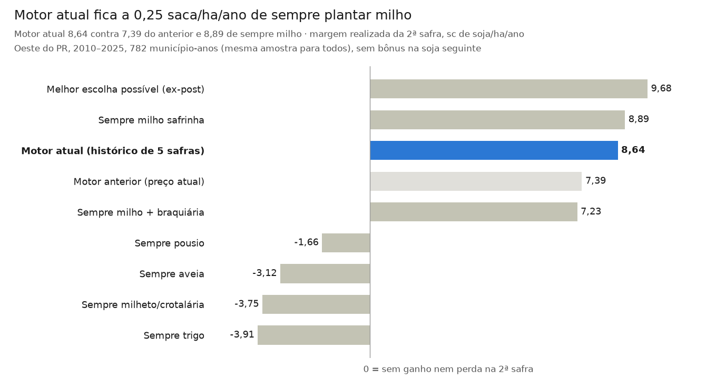

# Field Shift — Precisão do motor de rotação

15/11/2026 · Lucas Cordeiro · cópia do doc compartilhado: <https://claude.ai/artifact/9WLtaAGTT5ehDskrYJ1rMT>. Detalhes técnicos e como reproduzir: [`validation.md`](validation.md).

## Resumo

O motor está mais preciso na renda. A decisão por renda passou de 7,39 para 8,64 sacas de soja/ha/ano, testada em safras que o modelo não viu, e fica a 0,25 de "sempre plantar milho". O risco climático está calibrado na média e validado contra o ZARC, mas não prevê qual safra vai quebrar: um modelo mais rico foi testado e descartado por overfitting. Os benefícios agronômicos de longo prazo ainda não têm validação. A API agora devolve a incerteza de cada resultado.

| O que medimos | Resultado | Leitura |
| --- | --- | --- |
| Risco do milho safrinha vs ZARC (Oeste, 50 municípios) | Mesma classe de risco em 64 % dos casos; até 1 classe de diferença em 90 %; κ = 0,63 | Concordância boa |
| Perda prevista vs quebra real do milho safrinha (IBGE PAM, 2003–2025) | 24 % previsto vs 23 % observado | Calibrado na média |
| Prever qual safra quebra (fora da amostra) | Nenhum modelo testado supera a taxa média de quebra | Sem poder de previsão ano a ano |
| Produtividade esperada do próximo ano | Viés de −1 % no milho safrinha, −6 % na soja (antes −12 % e −11 %) | Sem viés relevante, exceto soja |
| Decisão só por renda (2010–2025, mesma amostra) | 8,64 sc de soja/ha/ano (antes 7,39), contra 8,89 de "sempre milho" e 9,68 da melhor escolha possível | Melhorou; quase empata com a regra simples |
| Erro da margem prevista da 2ª safra | 3,73 sc/ha (antes 4,63) | −19 % |
| Premissas de uso do solo (satélite) | 98 % da área é soja no verão; 93 % dos talhões fazem soja → milho safrinha | Confirmadas |
| Bônus na soja seguinte (satélite) | Não detectável no NDVI | Continua estimativa de literatura |
| Decisão só por renda no Paraná todo (288 municípios, 2010–2025) | 5,15 sc/ha/ano (antes 3,61); ganho em todas as 9 mesorregiões com dados | O histórico de renda vale fora do Oeste |
| Risco do milho safrinha no Paraná todo | Na semeadura padrão (01/02), o sul fica perto do observado (ex.: 26 % contra 23 %) e o norte fica abaixo (14 % contra 30 %) | Depende da data de semeadura, que a PAM não informa |

Não existe um número único de "acurácia": não há um gabarito do tipo "a rotação certa no talhão X era Y". Cada parte do motor é comparada com a melhor referência disponível para ela.

## Como validamos

A validação tem 6 camadas; 5 estão feitas e a do painel de agrônomos ainda não começou.

| # | Camada | Pergunta | Referência | Situação |
| --- | --- | --- | --- | --- |
| 1 | Sensibilidade e invariantes | O ranking é coerente? Quanto depende dos números estimados? | A própria lógica do motor (testes de propriedade) | Feita e refeita após as mudanças |
| 2 | Concordância com o ZARC | Risco climático e calendário batem com o zoneamento oficial? | ZARC 2025/2026 (MAPA/Embrapa), 399 municípios do PR | Feita e refeita após ajustes (conferida em 15/11) |
| 3 | Backtest histórico | Seguindo o motor no passado, o produtor teria ganhado mais? | IBGE PAM (produtividade e preço realizado), custos CONAB, NASA POWER; 50 municípios do Oeste | Feita e refeita após ajustes |
| 4 | Painel de agrônomos | Agrônomos ordenam as opções como o motor? | Ranking às cegas (Embrapa, IDR-PR, cooperativas) | Não começou |
| 5 | Satélite | Os talhões reais fazem o que o catálogo supõe? | MapBiomas 2019–2024 e NDVI do NASA HLS em 335 talhões ao redor do 72638 | Feita (conferida em 15/11) |
| 6 | Mudanças de precisão fora da amostra | As melhorias tentadas acertam mais em safras que o modelo não viu? | IBGE PAM, NASA POWER, CONAB | Feita |

Além disso, o clima da NASA POWER foi comparado com 7 estações do INMET: correlação de 0,94 na temperatura mínima, mas a POWER subestima os dias de geada em ~40 %.

## Como evitamos overfitting

No Oeste, os municípios quebram juntos na mesma safra. Por isso os 1.143 município-anos equivalem a só ~23 safras independentes, e toda comparação é feita por safra:

- **Uma safra de fora:** são 23 rodadas. Em cada uma, o modelo treina com 22 safras e prevê a que ficou de fora, de modo que todas as safras recebem uma previsão feita sem tê-las visto.
- **Só o passado:** a safra Y é prevista por um modelo treinado só com as safras anteriores a Y (13 safras de teste, 2013–2025). É assim que o motor é usado de verdade.
- **Intervalos por safra:** o bootstrap sorteia safras inteiras, não município-anos. Assim os 50 municípios de uma mesma safra não contam como 50 casos independentes.
- **Modelos e regra de adoção fixados antes:** os candidatos foram definidos pela agronomia, sem busca de variáveis nos dados. Uma mudança só entra no motor se ganhar fora da amostra com o intervalo acima de zero.

## Clima e calendário contra o ZARC

Depois de trocar o "veranico" pelo déficit hídrico na fase crítica, o risco do motor concorda bem com o ZARC e deixou de ser sistematicamente pessimista.

O ZARC é o zoneamento oficial do MAPA. Por município e por decêndio de semeadura, ele dá a classe de risco de perda (20, 30 ou 40 %) ou diz que a data não é indicada. Comparamos com a probabilidade de perda que o motor calcula para o mesmo município e data (geada + déficit hídrico), convertida nas mesmas classes.

| Milho safrinha, Oeste do PR | Motor antigo (veranico) | Motor atual (déficit hídrico) |
| --- | --- | --- |
| Mesma classe de risco do ZARC | 55 % | 64 % |
| Até 1 classe de diferença | 86 % | 90 % |
| Concordância κ (ponderada) | 0,54 | 0,63 |
| Concordância κ no Paraná todo | 0,40 | 0,50 |
| Casos mais pessimistas que o ZARC | 35–45 % | 19 % |
| Casos mais otimistas que o ZARC | 9–14 % | 16 % |
| Perda média, semeadura em 15/02 (ZARC: 23 %) | 29 % | 20 % |

- **Feijão:** κ subiu de 0,60 para 0,69 e a janela de semeadura do motor bate com a do ZARC no Oeste.
- **Semeadura tardia de milho (01/03 e 15/03):** o ZARC não indica essas datas em 48 % e 70 % dos municípios do Oeste. O motor continua aceitando, mas dá perda acima de 40 % em 83 % desses casos, e o card avisa que está fora do ZARC (sem crédito rural subsidiado, Proagro nem seguro). O aviso não muda a nota.
- **Sorgo:** é o ponto fraco (κ 0,27). O motor usa a janela de geada do milho para o sorgo e é pessimista em 34 % dos casos.
- **36 municípios frios** sem zoneamento de milho safrinha: o motor calcula perda baixa lá (mediana 12 %). Só o aviso do ZARC alerta o produtor; falta um indicador de frio ao longo do ciclo.
- O motor **nunca elimina** uma data que o ZARC indica.

## Risco climático: o modelo mais rico não generalizou

Tentamos prever as quebras do milho safrinha (produtividade ≥ 15 % abaixo da tendência; quebra em 23 % dos município-anos). Partimos dos sinais do motor e acrescentamos três: calor na floração, chuva na colheita e temperatura no estabelecimento (indicador indireto de cigarrinha). A medida é o ganho sobre "prever sempre 23 %" (Brier skill score); acima de zero é melhor.

| Modelo | Nos dados de treino | Uma safra de fora | Só o passado |
| --- | --- | --- | --- |
| Sinais do motor (geada, déficit hídrico) | +0,08 | +0,01 | +0,01 |
| + calor na floração + chuva na colheita | **+0,13** | **−0,09** | **−0,32** |
| + temperatura no estabelecimento | +0,14 | −0,08 | −0,30 |

- **É o caso típico de overfitting.** O modelo mais rico parece bom nas safras em que foi ajustado e fica pior que a taxa média nas que não viu. Com ~23 safras, cada variável a mais decora os anos ruins específicos (só 2021 responde por quase todo o sinal de déficit).
- **Os sinais do motor estão calibrados, mas não preveem:** fora da amostra, o ganho é ≈ 0.
- **Não há diferença real entre municípios.** Embaralhando as quebras entre municípios dentro de cada safra, a variação entre eles é a mesma do observado (p = 0,66). As quebras vêm da safra e atingem a região toda.
- **Decisão:** o critério de risco não mudou. Ele funciona como média climatológica, não como previsão, e a resposta diz isso (`confianca` = "baixa" no milho safrinha).

**Quebras do milho safrinha por sinal do motor** (1.143 município-anos):

| Sinal do motor | Quebra quando sinaliza | Quebra quando não sinaliza |
| --- | --- | --- |
| Geada na fase crítica | 30 % | 21 % |
| Veranico (motor antigo) | 21 % | 23 % |
| Déficit hídrico (motor atual) | 65 % | 20 % |
| Geada ou déficit (motor atual) | 38 % | 18 % |

## Renda: o histórico de 5 safras entrou na nota

Para milho safrinha, milho + braquiária e trigo, a margem da 2ª safra que entra na nota passou a ser a **média realizada das últimas 5 safras no município**, no lugar da estimativa a preço atual.

*Fonte: IBGE PAM, CONAB, SEAB/DERAL e NASA POWER · `scripts/validation/precision.py`.*

| Margem da 2ª safra na nota | Decisão (sc/ha/ano) | Acerto da melhor opção | Escolhe pousio | Erro da margem (sc/ha) |
| --- | --- | --- | --- | --- |
| Motor anterior: tendência × preço do ano anterior − custo | 7,39 | 72 % | 15 % | 4,63 |
| **Motor atual: média realizada das últimas 5 safras** | **8,64** | **82 %** | **2 %** | **3,73** |

- O ganho foi de **+1,26 sacas/ha/ano**: melhor em 13 de 16 safras, com intervalo de 90 % entre +0,60 e +2,05. Os números vêm de 782 município-anos de 2010–2025, a mesma amostra para os dois.
- **Nenhum parâmetro foi ajustado.** A janela de 5 safras já estava definida antes do teste. As misturas entre as duas estimativas foram piores que o histórico sozinho.
- **O motor anterior errava por decidir com o preço de um único momento:** em alguns anos a margem esperada do milho saía negativa e ele terminava positivo.
- Se o produtor informar preço, custo ou produtividade da cultura, o motor volta a usar a estimativa a preço atual, que é mais específica.
- **Ainda fica 0,25 abaixo de "sempre milho" (8,64 contra 8,89).** No Oeste, o milho safrinha é a melhor escolha em 81 % dos município-anos, e uma safra ruim (como 2021) puxa a média do histórico para baixo.

**Produtividade esperada** (erro mediano contra o ano seguinte):

| Cultura | Viés: média de 10 anos → tendência (atual) | Erro absoluto: antes → agora | Anos abaixo do "ano ruim" (p20) |
| --- | --- | --- | --- |
| Soja | −10,6 % → −6,3 % | 15,7 % → 15,8 % | 19 % |
| Milho safrinha | −11,7 % → −1,2 % | 18,8 % → 16,8 % | 15 % |
| Milho verão | −9,4 % → −1,2 % | 15,6 % → 15,1 % | 18 % |
| Trigo | −7,2 % → −0,2 % | 20,4 % → 19,8 % | 20 % |
| Feijão 2ª safra | −3,7 % → 0,0 % | 15,1 % → 17,2 % | 26 % |

O "ano ruim" (p20) deveria ficar abaixo em ~20 % dos anos e fica entre 15 % e 26 %: está calibrado.

**A renda não satura mais.** A fórmula antiga cortava a nota em 1,0 e deixava as duas opções de milho do 72638 empatadas no teto. A nova (0,5 + 0,5·tanh) tem a mesma inclinação perto de zero e nunca chega a 0 ou 1: os dois milhos agora tiram 0,914 e 0,909. O mesmo vale agora para os ajustes de solo e pragas do estado da área: num solo degradado o milheto/crotalária batia em 1,00 e empatava com o milho + braquiária; agora não empata mais.

## Incerteza na resposta da API

Cada opção do ranking traz um bloco `incerteza`, para o resultado não parecer mais preciso do que os dados permitem:

| Campo | O que mostra | Exemplo (72638, milho + braquiária) |
| --- | --- | --- |
| Faixa da renda | Margem incremental na pior e na melhor das últimas 5 safras | R$ 60 a R$ 2.943/ha |
| Faixa da nota | Nota com a renda nesses dois extremos | 0,679 a 0,817 |
| Nota por safra | Nota repetindo cada safra do histórico | 2021: 0,679 · 2025: 0,817 |
| Risco climático | Probabilidade, eventos e confiança | 20 %, geada + déficit, confiança "baixa" |
| Critérios estimados | Critérios que ainda são estimativa de catálogo | solo, pragas |

Cada bloco do ranking traz também a **estabilidade do 1º lugar**: repetindo a renda de cada uma das safras 2021–2025, milho + braquiária fica em 1º em 4 e milheto/crotalária em 1 (2021). Coberturas e pousio não têm faixa de renda, porque só têm custo; culturas sem histórico (sorgo, feijão) mostram só o pior caso (ano ruim p20). Com análise de solo pobre, ácido ou com pouca matéria orgânica, cada opção traz também `recuperacao_solo`: quanto custa recuperar o solo com ela (calagem, P/K extra e renda abdicada).

## Sensibilidade e empate técnico

O ranking é coerente (todos os testes de propriedade passam), mas as primeiras posições podem trocar com variações pequenas nos números estimados.

- **Testes de propriedade:** checam regras que o motor precisa obedecer sempre. Exemplos: subir o preço do milho nunca piora uma opção com milho e não mexe nas que não têm milho; subir um custo nunca aumenta a renda; o aviso do ZARC nunca muda a nota. A validação fora da amostra também tem testes que garantem que a safra testada nunca entra no treino.
- **Sensibilidade (refeita):** variamos ±20 % cada um dos 62 parâmetros estimados em 4 cenários do talhão 72638. Refeita depois do S fixo: na data padrão, milho + braquiária lidera com 0,799, contra 0,756 do milheto/crotalária e 0,751 do milho safrinha. Com soja no verão, só o preço do milho troca o 1º lugar: milho 20 % mais barato passa o milheto/crotalária para a frente. Com colheita tardia a diferença é de 0,010, e o custo da cobertura e atributos de catálogo das duas primeiras opções também trocam a ordem.
- **Pesos:** sorteando 1.000 combinações de pesos dos 5 critérios, milheto/crotalária fica em 1º em 57–74 % dos sorteios e milho + braquiária em 26–43 %. Os preços continuam sendo o que mais mexe no ranking, mais que qualquer estimativa de catálogo.
- **Empate técnico:** quando uma ou mais opções ficam a menos de 0,02 da melhor nota, a resposta marca `empate_tecnico` e o card avisa que a ordem pode trocar. No 72638, na data padrão e em 15/03, não há empate na data padrão (0,806 contra 0,751). Em 15/03, com o bônus dos ensaios, milheto/crotalária e milho + braquiária ficam a 0,011 e a resposta marca empate técnico.

## Checagem por satélite

As premissas de uso do solo do motor batem com o que os talhões reais fazem; os efeitos de longo prazo das rotações não aparecem no satélite.

| Pergunta | Resultado | Fonte |
| --- | --- | --- |
| Soja no verão é a regra? | Sim: 98,2 % dos 439.662 ha agrícolas foram soja todos os anos de 2019 a 2024 | MapBiomas |
| Segunda safra é a regra? | Sim: 75 % a 97 % dos talhões por ano; 68 % fizeram 2 safras em todos os anos observados | NDVI NASA HLS, 335 talhões ≥ 20 ha |
| A rotação que o motor detecta está certa? | Soja → milho safrinha em 93 % dos talhões | NDVI NASA HLS |
| Dias de solo descoberto (pousio vs milho) | Diferença medida de ~31 dias/ano; o catálogo usava 90 dias de diferença e agora usa 30 (pousio 90 contra milho 60) | NDVI < 0,35 |
| A soja seguinte é melhor após milho? | Sem diferença detectável após descontar talhão e safra (pico de NDVI −0,007) | 916 talhão-anos |

O catálogo agora usa a diferença medida para o pousio. As coberturas são raras demais na amostra para medir e continuam como estimativa. O bônus na soja seguinte não foi refutado: o NDVI satura perto de 0,9 numa lavoura de soja fechada, e um ganho de 2–3 sacas/ha é pequeno demais para aparecer. Ele continua sendo estimativa de literatura.

## Paraná todo

O motor roda nos 399 municípios. Repetimos as validações de renda e de risco por mesorregião do IBGE, com o mesmo código e sem reajustar nada (detalhes em [`validation.md`](validation.md) §7):

- **Renda:** o histórico de 5 safras ganha do estimador anterior em todas as mesorregiões. No Paraná, a decisão por renda passa de 3,61 para 5,15 sacas de soja/ha/ano (intervalo de 90 %: +0,72 a +2,50; melhor em 12 de 16 safras).
- **Cobertura vs milho:** na renda realizada, milheto/crotalária perde do milho safrinha em todas as mesorregiões (−8,7 sc/ha/ano no Paraná); só ganha em 17 % dos casos.
- **Risco:** o resultado depende da data de semeadura, que a PAM não informa. Com a data padrão do motor (01/02), o sul fica perto do observado (Centro-Sul 26 % contra 23 %, Sudoeste 25 % contra 22 %) e o norte fica abaixo (Norte Pioneiro 14 % contra 30 %). Com 15/02 acontece o contrário. Uma primeira versão deste teste usou só 15/02 e concluiu, errado, que o motor exagerava no sul. Não recalibramos: ajustar a geada a essas quebras seria ajustar datas que não conhecemos. Uma data por município tirada da janela do ZARC também não melhorou as mesorregiões (`validation.md` §7.3).
- **Ranking completo:** o motor punha milheto/crotalária em 1º em 86 % dos municípios, contra a renda observada. A causa principal era a régua da renda (S): ela era a margem da soja de cada município, e onde a soja rende mais o mesmo real de milho pesava até 3 vezes menos. Agora S = R$ 1.110/ha no Paraná todo (a margem mediana da soja no Oeste). Com isso o milho vai para 1º em 29 % do Paraná (antes 14 %) e em 76 % do Oeste (antes 58 %). A renda que se abre mão pela 1ª colocada cai de R$ 147 para R$ 55/ha na mediana. Quando a 1ª colocada não é a de maior renda, o card diz quanto se perde. No talhão 72638 a ordem não muda (milho + braquiária 0,799). Depois, com o bônus dos ensaios da Embrapa (abaixo), o milho vai para 1º em 46 % do Paraná.
- **Bônus na soja seguinte (15/11/2026):** os valores do catálogo foram trocados pelos de ensaios da Embrapa no Paraná, com faixa e fonte no card ([`pesquisa_ganho_soja_seguinte.md`](pesquisa_ganho_soja_seguinte.md)): milho + braquiária 3 → 5 sc/ha, trigo 1 → 3, aveia 2 → 3, milheto/crotalária 3 → 2 e feijão 0 → −1. O milho vai para 1º em 46 % do Paraná (antes 29 %) e em 88 % do Oeste (antes 76 %), mais perto do que aconteceu (a cobertura foi a melhor opção em 14–20 % dos casos). Em 7 das 10 mesorregiões a 1ª colocada passa a ser mais vezes a de maior renda; no total, cai de 57 % para 43 %, por causa do Noroeste (milheto em 1º e aveia com mais renda, ~R$ 195/ha) e do Norte Central. No talhão 72638 o milho + braquiária sobe para 0,806 e o milho safrinha passa a 2º. A PAM não registra a cultura anterior, então o bônus em si continua sem validação com dados observados.

## Limites conhecidos e próximos passos

O que ainda não está validado e o que fazer, por impacto:

1. **Datas de semeadura por município:** o Deral só publica o avanço do plantio por macrorregião e para safras recentes, então não há série por município. Testamos uma data aproximada tirada da janela do ZARC: semeando no fim da janela, a média do Paraná fica certa (25 % contra 25 %), mas o erro só muda de região (média de 7,6 contra 7,8 pontos), então não adotamos. Falta conseguir datas observadas (cooperativas, pedido ao Deral por núcleo).
2. **Painel de agrônomos:** 8 a 10 cenários ordenados às cegas por agrônomos (Embrapa, IDR-PR, cooperativas). É a única forma de validar a parte agronômica (quebra de pragas e cobertura; o bônus já vem de ensaios), que decide a disputa entre milho + braquiária e milheto/crotalária.
3. **Dados por talhão:** a produtividade de cada talhão, vinda de cooperativas ou produtores parceiros, é o que pode tornar o risco e a renda mais precisos. Não existe base pública por talhão no Paraná (IBGE, CONAB e Deral são municipais ou regionais), e o NDVI do HLS não detecta o efeito da cultura anterior; a API já aceita a produtividade do próprio produtor (`ajustes.produtividade`). Com dados municipais e ~23 safras, o risco climático chegou ao limite.
4. **Sorgo e municípios frios:** dar ao sorgo uma janela de geada própria e criar um indicador de frio ao longo do ciclo.
5. **Pragas:** uma série de anos de cigarrinha/enfezamento permitiria testar de novo as quebras que o clima não explica (2005, 2008, 2011, 2024).
6. **Data de colheita da soja:** substituir a estimativa de 10/01 pela data dos boletins regionais do Deral, quando houver série do Oeste.
7. **Solo:** os efeitos de fertilidade e matéria orgânica têm direção com fonte, mas o tamanho (±0,15) é escolha de modelagem; o ganho de matéria orgânica por safra no Oeste do PR não tem medição.

Outros limites:
- O clima vem de células de ~50 km, então talhões vizinhos têm o mesmo clima.
- A NASA POWER subestima geadas em ~40 %.
- Os preços são médias do Paraná, e os custos vêm de outras praças do PR, porque a CONAB não tem planilha do Oeste.
- O histórico de renda pesa uma safra extrema (como 2021) em ~2 sacas/ha na média; a faixa em `incerteza` mostra isso.
- A tabela do ZARC vale para a safra 2025/2026 e precisa ser atualizada a cada ano.
