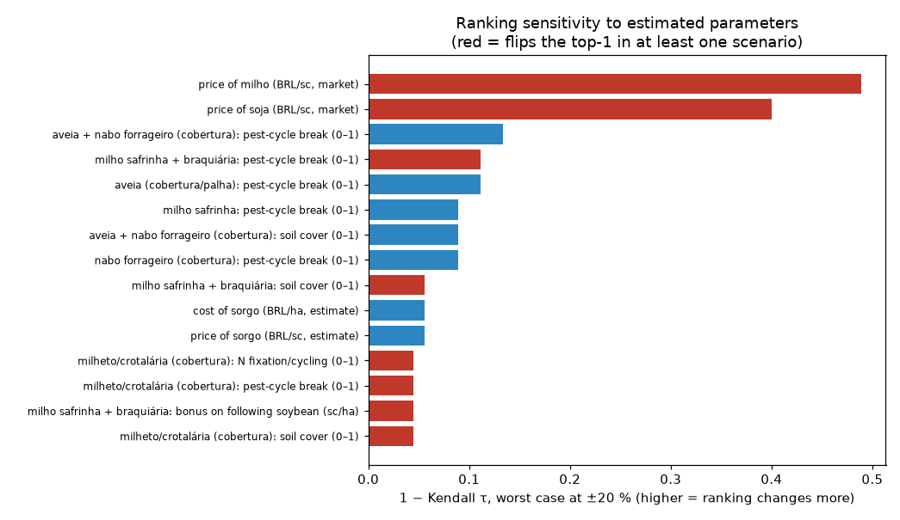
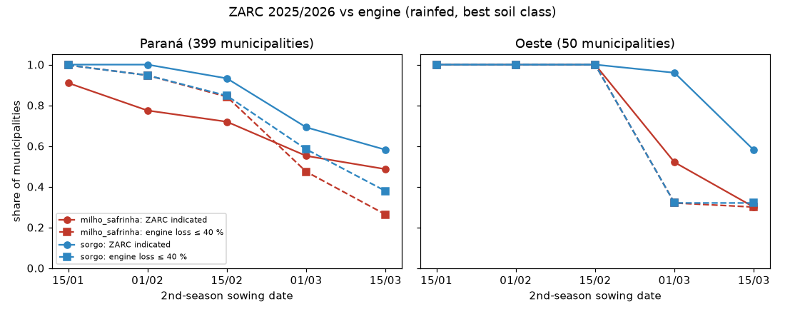
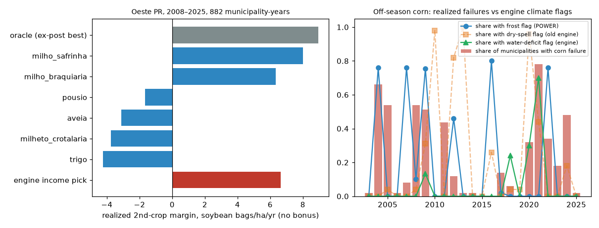
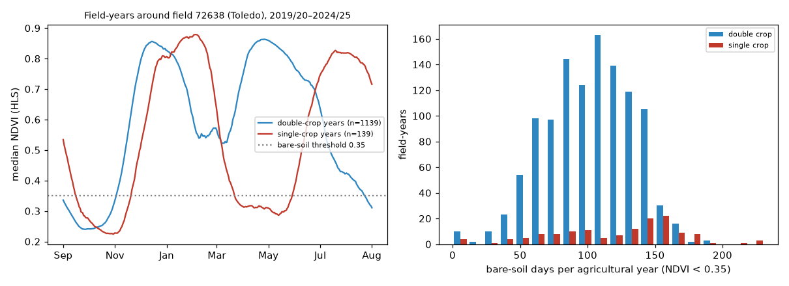

# Field Shift — Engine validation

How we check that the rotation engine (`docs/motor.md`) gives sound answers. Date: 15/11/2026. Pilot: Western Paraná, field 72638.

## Strategy

There is no ground-truth label of the kind "rotation X was the right choice on field Y", so a single accuracy number does not exist. Validation is done in layers, each one against the best reference available:

| # | Layer | Question | Reference | Status |
|---|---|---|---|---|
| 1 | Sensitivity + invariants | Is the ranking coherent and how much does it depend on the estimated numbers? | The engine's own logic (metamorphic properties) | Done (section 1) |
| 2 | ZARC agreement | Do the calendar rules agree with the official climate-risk zoning? | ZARC (MAPA/Embrapa) | Done (section 2) |
| 3 | Historical backtest | Following the engine in past seasons, would the farmer have earned more? | IBGE PAM (yields and realized prices), CONAB costs, NASA POWER | Done (section 3) |
| 4 | Expert panel | Do agronomists rank the options like the engine? | Blind ranking by agronomists (Embrapa, IDR-PR, cooperatives) | Not started (depends on people) |
| 5 | Satellite check | Do real fields behave as the catalog assumes (rotations practised, effect on the following soybean)? | MapBiomas, HLS NDVI | Done (section 5) |
| 6 | Accuracy changes, out of sample | Do the attempted accuracy improvements predict better on seasons they never saw? | IBGE PAM, NASA POWER, CONAB (leave-one-season-out and past-only tests) | Done (section 6) |
| 7 | Statewide | Do layers 3 and 6 hold outside the Oeste pilot, in all of Paraná? | Same as 3 and 6, for the 399 municipalities, by IBGE mesoregion | Done (section 7) |

Component checks that already exist: NASA POWER against 7 INMET stations (Tmin correlation 0.94, POWER underestimates frost days by ~40%; `docs/motor.md`, `src/field_shift/climate/station_validation.py`).

## 1. Sensitivity and invariants

### 1.1 Invariant (metamorphic) tests

Properties that must hold whatever the exact catalog values are. File: `tests/test_invariants.py` (24 tests, offline, ~3 s, part of `uv run pytest`). **All pass**; no engine bug was found.

| Group | Invariant |
|---|---|
| Structure | Same inputs + `data_referencia` → identical ranking and scores |
| Structure | Score and the 5 criteria are in [0, 1]; ranking is sorted by score |
| Structure | Every eliminated rotation has at least one reason; soybean on soybean is always eliminated |
| Structure | The current rotation is always reported (`atual`), also when it is eliminated |
| Weights | Multiplying all weights by a constant does not change the ranking |
| Weights | Raising the weight of a criterion never moves down the rotation that is best on that criterion (all 5 criteria) |
| Weights | Ranking a subset of rotations keeps their relative order (absolute 0–1 scales, no coupling between candidates) |
| Income | A higher corn price never lowers the income criterion of a corn rotation and leaves corn-free rotations unchanged |
| Income | A higher cost (off-season corn, wheat, oat, millet/crotalaria, oat + radish, fallow) never raises any income criterion |
| Income | A higher bonus on the following soybean never lowers the income criterion |
| Climate | A later second-season sowing (15/01 → 15/03) never improves the climate-risk criterion of off-season corn and sorghum |
| Water | Irrigation never lowers the water or the risk criterion; it raises water for off-season corn |
| Calendar | Harvest after 15/03 leaves only fixed-date crops (winter crops and covers) |
| Climate | Cover crops and fallow carry no climate risk (risk criterion = 1.0) |

Climate-risk criterion by second-season sowing date (field 72638, POWER 1991–2024), used by the frost invariant:

| Sowing | 15/01 | 01/02 | 15/02 | 01/03 | 15/03 |
|---|---|---|---|---|---|
| Off-season corn (risk criterion, 1 = no risk) | 0.830 | 0.779 | 0.649 | 0.467 | 0.208 |
| Sorghum | 0.941 | 0.882 | 0.735 | 0.529 | 0.235 |
| Off-season corn (water criterion) | 0.828 | 0.858 | 0.901 | 0.931 | 0.965 |

The water criterion **rises** with later sowing: the critical phase moves into May–June, when ET0 is low, so ΣETa/ΣETc gets closer to 1. This follows from the FAO-56 balance, but an agronomist should confirm that it reflects Western Paraná (frost already covers the late-sowing penalty through the risk criterion).

### 1.2 Sensitivity analysis

Code: `src/field_shift/validation/sensitivity.py` (patches copies of the catalog entries or passes price/cost overrides; engine defaults are never changed). Runner: `scripts/validation/sensitivity.py`.

**Scenarios** (field 72638; ranking = the `agora` block, i.e. candidates with the current summer crop):

| Key | Scenario | Baseline top-3 (score) |
|---|---|---|
| `soy_grain_fill` | Soybean in grain filling on 01/12 (harvest ~02/01, sowing 15/01) | corn + brachiaria 0.768 · millet/crotalaria 0.759 · oat + radish 0.713 |
| `soy_default` | Soybean, no stage (catalog assumption, sowing 01/02) | corn + brachiaria 0.764 · millet/crotalaria 0.759 · oat + radish 0.713 |
| `soy_late` | Soybean harvested ~25/02 (sowing 01/03) | millet/crotalaria 0.759 · corn + brachiaria 0.723 · oat + radish 0.713 |
| `corn_milk` | Summer corn in milk stage on 01/12 | millet/crotalaria 0.621 · oat + radish 0.576 · oat 0.569 |

**Method.**

- *One at a time:* each of the 62 parameters is moved by −20 % and +20 %. These are every catalog attribute of the second crops (bonus on the following soybean, cover, N fixation, bare-soil days, pest break), the summer-corn bonus, the corn-on-corn penalty, the cost and price items flagged as estimates, and the market prices of soybean, corn, wheat and beans. Metrics against the baseline: top-1 change, top-3 Jaccard overlap, Kendall τ of the full ranking, and the largest score shift.
- *Weights:* each weight is set to 0 and to 10 with the others at the default. Then 1,000 random weight vectors (uniform 0–10, seed 42) count how often each rotation is top-1 or in the top-3.

**Results.**

1. **The top-1 is a technical tie between corn + brachiaria and millet/crotalaria.** The gap is 0.005–0.009 points in the two early-sowing scenarios. A ±20 % change in 10 of the 62 parameters flips it:
   - market prices: soybean +20 %, corn −20 %;
   - corn + brachiaria: pest break, cover, bonus;
   - millet/crotalaria: cover, N fixation, pest break, bonus, cost.

   The two rotations swap places but stay together at the top, and the top-3 overlap never falls below 0.5. With a late harvest (gap 0.036) and after summer corn (gap 0.045) only the prices flip the top-1.
2. **Prices move the ranking most.** Corn and soybean prices (data, but volatile) give a worst-case Kendall τ of 0.51 and 0.60, against ≥ 0.87 for any catalog estimate. The engine is therefore more sensitive to the market than to our estimates. This argues for using up-to-date prices (the farmer's or DERAL's weekly ones).
3. **Of the estimates, pest break matters most.** Oat + radish, corn + brachiaria, oat, off-season corn and radish have the lowest τ (0.87–0.91) and reshuffle positions 2–5. Next come the cover and bonus of the top-2 rotations. Bare-soil days, N fixation of the grain crops, fallow and wheat parameters, and the corn-on-corn penalty do not change the top-3 in any scenario (full table: `data/processed/validation/sensitivity_importance.csv`).
4. **Weights.** With random weights, millet/crotalaria is top-1 in 74–99 % of the draws and in the top-3 in 100 %. Corn + brachiaria is top-1 in 1–26 %. The current off-season corn reaches the top-3 in only 1–21 %. The default weights (income 5, others 3) favour corn + brachiaria. Setting income to 0, or any other criterion to 10, switches the top-1 to millet/crotalaria in the early-sowing scenarios.



**What to validate first with an agronomist/Embrapa** (ordered by impact on the ranking):

1. Pest-cycle break attribute of corn + brachiaria, millet/crotalaria, oat + radish, oat and radish.
2. Soil cover of corn + brachiaria, millet/crotalaria and oat + radish.
3. Bonus on the following soybean of corn + brachiaria and millet/crotalaria (the literature survey in `pesquisa_ganho_soja_seguinte.md`).
4. Establishment cost of millet/crotalaria.
5. Sorghum price and cost (they reorder the middle of the ranking).

Low priority: bare-soil days, wheat and fallow attributes, corn-on-corn penalty (no effect on the top-3 at ±20 %).

**Consequence for the product.** When the top-2 differ by less than ~0.02, the response should present them as a technical tie, so the recommendation does not look more precise than the data allow. Tracked in `docs/pendencias.md`.

**Rerun after the engine changes of §2.4 and §3.4 (trend yield, water deficit).** On field 72638 corn + brachiaria now leads clearly at the default date (0.821 vs off-season corn 0.774 and millet/crotalaria 0.757). ±20 % on 19 of 62 parameters moves the top-1 or the top-3; with soybean in summer only the prices flip the top-1 (corn −20 % or soybean +20 % → millet/crotalaria). With summer corn the top two are tied (0.623 vs 0.621) and most catalog estimates flip them. Monte Carlo weights: millet/crotalaria 50 % and corn + brachiaria 50 % of the top-1 (millet/crotalaria in the top-3 in 100 %). The numbers above are from the earlier engine.

**Rerun after the §6 changes (track-record income, non-saturating income score, fallow 90 bare days).** Baseline top-3 at the default date: corn + brachiaria 0.795 · millet/crotalaria 0.757 · off-season corn 0.747; late sowing: corn + brachiaria 0.762 · millet/crotalaria 0.757. ±20 % on 29 of 62 parameters moves the top-1 or the top-3. With the default and grain-fill dates only the prices flip the top-1 (soybean +20 % or corn −20 % → millet/crotalaria); in the late scenario (gap 0.005) the catalog attributes of the top-2 also flip it, so that case is still a near tie. Monte Carlo weights: millet/crotalaria first in 59–74 % of the draws, corn + brachiaria in 26–41 %, off-season corn ≤ 1 %. Prices remain the most influential inputs (worst-case Kendall τ 0.56 for corn, 0.64 for soybean, ≥ 0.83 for any catalog estimate).

**Rerun after the fixed income scale (§7.5, S = BRL 1,110/ha).** Baseline top-3 at the default date: corn + brachiaria 0.799 · millet/crotalaria 0.756 · off-season corn 0.751; late sowing: corn + brachiaria 0.766 · millet/crotalaria 0.756 (gap 0.010). ±20 % on 22 of 62 parameters moves the top-1 or the top-3. Default and grain-fill dates: only corn −20 % flips the top-1 (soybean +20 % no longer does); late scenario: corn −20 %, the millet/crotalaria cost and three catalog attributes of the top-2. Monte Carlo weights: millet/crotalaria first in 57–74 % of the draws, corn + brachiaria in 26–43 %.

### 1.3 How to reproduce

```bash
uv run pytest tests/test_invariants.py          # invariants (also in the full suite)
uv run python scripts/validation/sensitivity.py # sensitivity: prints the tables, ~10 s
```

Outputs (`data/processed/validation/`, not in git): `sensitivity_baseline.csv`, `sensitivity_oat.csv` (every run), `sensitivity_importance.csv` (per parameter), `sensitivity_weights.csv`, `sensitivity_weights_mc.csv`. Figure: `docs/figuras/validation_sensitivity.png`.

## 2. ZARC agreement

ZARC (Zoneamento Agrícola de Risco Climático, MAPA/Embrapa) is the official sowing calendar of Brazil and the basis for rural credit (Pronaf/Proagro) and subsidised insurance. It is the strongest external reference for the engine's calendar rules and climate risk.

### 2.1 Data and method

- **Source:** "Tábua de risco" for season 2025/2026, open CSV at [dados.agricultura.gov.br](https://dados.agricultura.gov.br/dataset/tabua-de-risco-zoneamento-agricola-de-risco-climatico) (CC-BY). There is one row per crop × municipality × soil class × cycle group, and 36 ten-day periods (*decêndios*: days 1–10, 11–20, 21–end of each month). Each period holds the risk class 20, 30 or 40 (% chance of loss) or 0 (not indicated). Only Paraná rows are kept (105,992 of 1,026,973), in `data/raw/zarc/tabua_2025_2026_pr.parquet`.
- **ZARC side:** rainfed rows only. For each soil class the lowest risk over cycle groups is taken, then the lowest over soil classes (`best`). This is the most permissive reading ("is there a ZARC-indicated option in this municipality?"). The share of soil classes in which the period is indicated is also kept.
- **Engine side:** for each of the 399 Paraná municipalities (centroid → NASA POWER cell) and each engine sowing date (15/01, 01/02, 15/02, 01/03, 15/03):
  - *eligibility*: is the candidate eliminated by the hard rules (`engine.check_rules`)?
  - *loss probability*: 1 − Π(1 − pᵢ) over the candidate's climate risks (frost in flowering/grain filling for the sowing date, dry spell ≥ 15 days in Mar–Apr; section 2.2 is this original engine, section 2.4 the engine with the water deficit). This is the same quantity as the risk criterion (risk criterion = 1 − loss), and it is mapped to the ZARC classes (≤ 20 %, ≤ 30 %, ≤ 40 %, > 40 % = not indicated).
- **Crop mapping:**

  | Engine | ZARC |
  |---|---|
  | off-season corn | Milho 2ª Safra |
  | corn + brachiaria | Milho 2ª Safra consorciado com Braquiária |
  | sorghum | Sorgo Granífero 2ª Safra |
  | beans | Feijão 2ª Safra |
  | wheat / oat (sown 01/05) | Trigo / Aveia |
  | soybean (15/10) | Soja |
  | summer corn (01/10) | Milho 1ª Safra |

  Millet/crotalaria and radish are not zoned.
- **Metrics:**
  - eligibility agreement (engine valid vs ZARC indicated), counting both ways of disagreeing;
  - loss agreement: exact class, within one class, linear-weighted Cohen's κ, Spearman ρ between engine loss and ZARC class;
  - directional agreement: when ZARC does not indicate, does the engine give loss > 40 %? When ZARC indicates, loss ≤ 40 %?

  Scopes: all of Paraná (399 municipalities) and the Oeste mesoregion (50, the pilot).

### 2.2 Results

**Eligibility.** The engine **never eliminates** a sowing that ZARC indicates (0 cases in 7,980 crop × municipality × date combinations). The opposite does happen: the engine keeps options that ZARC does not indicate.

| Share of municipalities (Oeste) | 15/01 | 01/02 | 15/02 | 01/03 | 15/03 |
|---|---|---|---|---|---|
| Off-season corn: ZARC indicated | 1.00 | 1.00 | 1.00 | **0.52** | **0.30** |
| Off-season corn: engine valid | 1.00 | 1.00 | 1.00 | 1.00 | 1.00 |
| Off-season corn: engine loss ≤ 40 % | 1.00 | 1.00 | 1.00 | 0.32 | 0.20 |
| Sorghum: ZARC indicated | 1.00 | 1.00 | 1.00 | 0.96 | **0.58** |
| Sorghum: engine loss ≤ 40 % | 1.00 | 1.00 | 1.00 | 0.32 | 0.32 |
| Beans: ZARC indicated / engine valid | 1.00 / 1.00 | 1.00 / 1.00 | 1.00 / 1.00 | 0.00 / 0.00 | 0.00 / 0.00 |

- **Up to 15/02 the engine and ZARC agree 100 % in the Oeste**, for all four crops.
- **Beans:** the engine window (15/01–28/02) matches ZARC exactly in the Oeste and in 98 % of Paraná. The 35 disagreements are early dates in cold municipalities.
- **Off-season corn and corn + brachiaria:** the engine has no sowing window and keeps 01/03 and 15/03 valid. ZARC drops them in 48 % and 70 % of the Oeste municipalities. In all of Paraná, eligibility agreement is 69 % (622 of 1,995 cases are valid in the engine and not indicated by ZARC).
- **Sorghum:** the engine window ends 15/03. ZARC ends at 10/03 (period 7) in 42 % of the Oeste municipalities.
- **36 municipalities** (cold south/Campos Gerais) have no 2nd-season corn zoning at any date. There the engine's lowest loss is a median 25 % (range 9–49 %), so it misses what makes the region unsuitable (the frost and dry-spell indicators alone do not capture it).
- **Fixed dates:** wheat and oat on 01/05, soybean on 15/10 and summer corn on 01/10 are indicated in 100 % of the Oeste municipalities (risk class 20). In all of Paraná, wheat on 01/05 is indicated in 82 % and oat in 71 % (north of the state, where winter sowing starts earlier).

**Loss probability against the ZARC class.**

| Crop | Scope | Spearman ρ | Exact class | Within 1 class | κ (linear) | ZARC out → engine loss > 40 % | ZARC in → engine loss ≤ 40 % |
|---|---|---|---|---|---|---|---|
| Off-season corn | Oeste | 0.64 | 0.55 | 0.86 | 0.54 | 0.88 | 0.88 |
| Off-season corn | Paraná | 0.64 | 0.46 | 0.75 | 0.40 | 0.79 | 0.76 |
| Corn + brachiaria | Oeste | 0.61 | 0.52 | 0.86 | 0.52 | 0.88 | 0.88 |
| Sorghum | Oeste | 0.38 | 0.64 | 0.79 | 0.27 | 0.74 | 0.78 |
| Sorghum | Paraná | 0.58 | 0.62 | 0.77 | 0.43 | 0.92 | 0.88 |
| Beans | Oeste | 0.64 | 0.63 | 0.84 | 0.60 | 0.74 | 1.00 |
| Wheat (01/05) | Paraná | 0.55 | — | — | — | — | — |

- **The risk signal points the same way as ZARC** (ρ 0.6–0.7 for corn and beans). Where ZARC drops off-season corn in the Oeste, the engine already gives a loss above 40 % in 88 % of cases. The engine is therefore not "wrong" on late corn: its risk criterion penalises it, it just does not eliminate it.
- **The engine is more pessimistic than ZARC** at intermediate dates. For off-season corn at 15/02 in the Oeste its mean loss is 29 % (class 30), against a mean ZARC class of 23 %. Overall it is more pessimistic in 35–45 % of cases and more optimistic in only 9–14 %. Likely causes:
  - the frost threshold (≤ 3 °C air temperature at 2 m in the critical phase);
  - the dry spell counted in Mar–Apr independently of the sowing date;
  - ZARC working per soil class with a water-balance model (ISNA) instead of a fixed-window dry-spell count.
- **Sorghum is the weakest match** in the Oeste (κ 0.27). The engine uses the corn frost window as an approximation, so at 01/03 it gives loss > 40 % in 68 % of the municipalities where ZARC indicates sorghum with class 20.

### 2.3 Consequences for the engine (tracked in `docs/pendencias.md`)

1. **Use the ZARC table directly** (done as a warning, see 2.4). It is open, per municipality, per ten-day period and per crop. Mark (or optionally eliminate) the candidates whose sowing date is outside ZARC for the field's municipality, instead of the generic warning `ZARC_WARNING`. This closes the 01/03–15/03 corn gap and the 36 municipalities without zoning, and the card can cite the ordinance (`Portaria`).
2. **End the sorghum window at 10/03**, or derive it from ZARC per municipality.
3. **Review the frost/dry-spell model of sorghum** (the corn/beans pessimism was fixed by the water deficit, see 2.4; sorghum is still open) (it has its own frost sensitivity, not corn's) and the engine's pessimism at intermediate dates (threshold and dry-spell window). Recalibrate against the ZARC classes.

### 2.4 After the engine changes (water deficit + ZARC warning)

Two changes followed sections 2.2 and 3.2:

1. **Water deficit replaces the dry spell** in the risk criterion of off-season corn, corn + brachiaria, beans and off-season soybean: probability = share of the 34 years with ΣETa/ΣETc < 0.55 in the crop's critical phase (FAO-56 daily balance with the field's soil and the chosen sowing date; `agua.balanco.DEFICIT_THRESHOLD`). Without soil data it falls back to the cell dry spell. Sorghum still counts only frost.
   - *Calibration of the threshold* (50 Oeste municipalities, 2003–2025, PAM off-season corn failure = yield ≥ 15 % below trend): years below 0.55 failed in 65 % of the cases vs 20 % otherwise (mean yield deviation −26.7 %); the old dry-spell flag gave 21 % vs 23 %. It also agrees better with the ZARC classes (Oeste corn κ 0.63 vs 0.54 with the dry spell).
2. **ZARC as a warning only** (`field_shift.zarc`, table built by `ingest/zarc_pr.py`): each candidate is checked for the field's municipality and sowing date; outside ZARC the card gets a specific warning and the item a `zarc` field. Scores do not change (`tests/test_zarc.py::test_zarc_never_changes_scores`). On field 72638 (harvest 10/03 → sowing 15/03) the corn candidates are now flagged "Fora do ZARC 2025/2026 em Toledo".

Same comparison as 2.2, rerun with the new engine (soil from SoilGrids in a ~100 ha square at each municipality centroid):

| Crop | Scope | Exact class | Within 1 class | κ (linear) | Spearman ρ | ZARC out → loss > 40 % | ZARC in → loss ≤ 40 % | More pessimistic | More optimistic |
|---|---|---|---|---|---|---|---|---|---|
| Off-season corn | Oeste | 0.55 → **0.64** | 0.86 → **0.90** | 0.54 → **0.63** | 0.64 → 0.59 | 0.88 → 0.83 | 0.88 → **0.90** | 35–45 % → **19 %** | 9–14 % → 16 % |
| Off-season corn | Paraná | 0.46 → **0.54** | 0.75 → **0.81** | 0.40 → **0.50** | 0.64 → 0.63 | 0.79 → 0.67 | 0.76 → **0.87** | → 28 % | → 18 % |
| Corn + brachiaria | Oeste | 0.52 → **0.62** | 0.86 → **0.90** | 0.52 → **0.61** | 0.61 → 0.58 | 0.88 → 0.83 | 0.88 → **0.90** | → 20 % | → 18 % |
| Beans | Oeste | 0.63 → **0.74** | 0.84 → **0.90** | 0.60 → **0.69** | 0.64 → 0.67 | 0.74 → 0.71 | 1.00 → 1.00 | → 12 % | → 15 % |
| Sorghum | Oeste | 0.64 | 0.79 | 0.27 | 0.38 | 0.74 | 0.78 | 34 % | 2 % |

- **The systematic pessimism is gone.** Off-season corn at 15/02 in the Oeste: mean engine loss 29 % → 20 % (ZARC mean class 23 %); at 01/02, 12 % vs ZARC 20 %. The errors are now balanced (≈ 1 in 5 cases on each side) instead of mostly pessimistic.
- **Late sowing is still penalised** (Oeste corn, mean loss 34 % at 01/03 and 49 % at 15/03; ZARC drops 48 % and 70 % of the municipalities on those dates), but slightly less sharply than before (83 % instead of 88 % of the ZARC-out cases have loss > 40 %). The remaining cases are now covered by the ZARC warning.
- **Cold municipalities.** In the 36 municipalities with no 2nd-season corn zoning the engine's lowest loss went from a median 25 % to 12 % (range 3–44 %): the soil water balance is benign there, and what makes the region unsuitable (frost risk across the whole cycle, cold-season length) is not in the two indicators. The ZARC warning ("cultura sem zoneamento no município") is what now tells the farmer.
- **Sorghum is unchanged** (no deficit risk; frost window borrowed from corn): still the weakest match and still the most pessimistic (34 %). Tracked.
- **Eligibility** is unchanged by design (ZARC only warns): the engine still keeps corn at 01/03 and 15/03 valid where ZARC does not indicate it, now with an explicit warning.



The figure shows the new engine.

### 2.5 How to reproduce

```bash
uv run python scripts/validation/zarc_agreement.py   # builds the table if missing (~220 MB download), ~20 min (soil water balance per municipality)
uv run pytest tests/test_validation_zarc.py          # helpers (ten-day periods, loss classes, crop mapping)
```

Outputs (`data/processed/validation/`): `zarc_second_window.csv` (one row per municipality × crop × sowing date), `zarc_fixed_dates.csv`, `zarc_summary_parana.csv`, `zarc_summary_oeste.csv`. Code: `src/field_shift/validation/zarc.py`. Figure: `docs/figuras/validation_zarc.png`.

## 3. Historical backtest

Question: if the engine's logic had been used in past seasons, with only the information available at the time, how would it have done against what actually happened? Scope: the 50 municipalities of the Oeste mesoregion, 2003–2025.

### 3.1 Data and method

- **Yields:** IBGE PAM per municipality and year (soybean, off-season and summer corn, wheat, beans, oat; `data/raw/ibge/`).
- **Prices:** realized prices from PAM, computed as production value ÷ production for the Oeste aggregate per year (soybean, corn, wheat).
- **Costs:** the CONAB variable cost (≈ COE) of each season, Londrina-PR sheets (off-season corn 1999–2026, wheat 1999–2025). Covers and fallow have no historical series, so their current reference cost is kept constant *in soybean bags*.
- **Unit:** every margin is in **soybean bags per hectare** (BRL ÷ soybean price of the same year). This lets years be averaged without a deflator.
- **Climate:** frost in the critical phase of off-season corn sown 15/02 and dry spell ≥ 15 days in Mar–Apr, from NASA POWER at the municipality centroid (`indicadores_anuais.parquet`; agricultural year Y → corn harvested in Y + 1).

Three checks:

- **a) Yield expectation.** The engine uses the mean of the last 10 years of PAM and p20 as the "bad year". For each year Y, take the years Y−10..Y−1 and compare with the realized yield of Y.
- **b) Climate risk.** A crop failure is a PAM off-season-corn yield 15 % or more below the municipal linear trend. Do the engine's frost/dry-spell years coincide with failures, and does its loss probability match the observed failure rate?
- **c) Decision.** Each year, choose the second crop using the engine's **income** logic with the previous year's information: expected margin = expected yield × last year's price ratio (crop/soybean) − this season's CONAB cost. Options are off-season corn, corn + brachiaria, wheat, oat, millet/crotalaria and fallow. Then measure the realized margin against fixed strategies and the ex-post best option ("oracle"). The bonus on the following soybean (catalog estimate, not observable in PAM) is added only in a separate run. Only the income criterion can be backtested in money; soil, water and pest criteria have no realized counterpart in PAM.

### 3.2 Results

**a) Yield expectation: unbiased dispersion, biased level.**

| Crop | Median abs. error, 10-y mean | Median bias, 10-y mean | Median bias, 10-y trend | Realized below p20 |
|---|---|---|---|---|
| Soybean | 16 % | −11 % | −6 % | 21 % |
| Off-season corn | 19 % | **−12 %** | −1 % | 17 % |
| Summer corn | 16 % | −9 % | −1 % | 21 % |
| Wheat | 20 % | −7 % | 0 % | 21 % |
| Beans (2nd season) | 15 % | −4 % | +1 % | 27 % |
| Oat | 13 % | −4 % | −2 % | 20 % |

(n = 116–900 municipality-years per crop, 2008–2025. Bias = (expected − realized) / realized; negative means the engine underestimates.)

- The **"bad year" (p20) is well calibrated**: the realized yield falls below it in 17–21 % of the years, against the 20 % that p20 implies. Beans are the exception (27 %).
- The **10-year mean underestimates the yield by 7–12 %** for the main crops, because the technology trend raises yields every year. A linear trend over the same 10 years removes the bias (−1 % to 0 %; soybean −6 %) with the same error.

**b) Climate risk against real failures of off-season corn (1,143 municipality-years).**

| Engine flag (POWER) | Years flagged | Failure if flagged | Failure if not | Mean yield deviation if flagged / not |
|---|---|---|---|---|
| Frost in the critical phase (sowing 15/02) | 19 % | **30 %** | 21 % | **−6.4 % / +1.4 %** |
| Dry spell ≥ 15 days in Mar–Apr | 22 % | 21 % | 23 % | −1.1 % / +0.2 % |
| Either | 38 % | 26 % | 21 % | −3.6 % / +2.2 % |

- **The frost signal is real.** Frost years carry 1.4× more failures and a 7.8-point yield gap; 2004, 2009 and 2022 are matched, while 2007 and 2016 were flagged with no failure.
- **The dry-spell indicator does not predict failures.** In 2010 and 2013 nearly every municipality was flagged and yields were above trend. The largest failures of the series were missed or only partly flagged: 2005, 2008, 2011, 2021 (drought in Apr–May plus late frost) and 2024. The 15-day Mar–Apr count does not capture the deficits that actually hit the crop.
- **Level:** the engine's loss probability (frost + dry spell climatology) averages 37 % per municipality, against an observed failure rate of 23 %. The engine is pessimistic, as also seen against ZARC (§2). Across municipalities inside the Oeste, the two do not correlate (ρ ≈ 0): the region is climatically homogeneous at the 50 km POWER scale.

**c) Decision backtest (882 municipality-years, 2008–2025, soybean bags/ha/yr).**

| Estimator of the expected margin | Engine income pick | Always off-season corn | Oracle | Regret | Hit rate | Picks fallow |
|---|---|---|---|---|---|---|
| **Engine today** (10-y mean yield, last-year price) | **4.64** | 8.01 | 8.93 | 4.29 | 57 % | 24 % |
| Trend yield, last-year price | 6.64 | 8.01 | 8.93 | 2.30 | 71 % | 14 % |
| Track record (mean realized margin of the last 5 seasons)¹ | 8.64 | 8.89 | 9.68 | 1.04 | 82 % | 2 % |

¹ Needs 5 past seasons, so 782 municipality-years.

- **The engine's income logic, as it is today, would have lost 3.4 bags/ha/yr against simply always planting off-season corn** (4.64 vs 8.01). In 24 % of the cases it switched to fallow because the expected corn margin came out negative. Three things combine: the yield underestimate (a), a single year's price snapshot (corn was cheap relative to soybean in 2014, 2015 and 2017), and the CONAB high-tech cost. Corn then paid well in those years (2015, 2016, 2018).
- **Correcting the yield bias with a trend recovers half of the loss** (regret 4.3 → 2.3). Averaging the price over 3–5 years does not help much. **A track-record estimator** (mean realized margin of the last 5 seasons) brings the hit rate to 82 % and the regret to 1 bag/ha. It is still slightly below "always corn", because off-season corn is the ex-post best in 81 % of the municipality-years in the Oeste.
- **Price of the soil-oriented recommendations** (fixed strategies, no bonus):
  - off-season corn 8.0 bags/ha/yr;
  - corn + brachiaria 6.4 (−1.7, the brachiaria seed);
  - fallow −1.7, oat −3.1, millet/crotalaria −3.8 (−11.8 against corn);
  - wheat −4.2.

  The catalog bonus on the following soybean is 3 bags/ha for both corn + brachiaria and millet/crotalaria. That is enough to pay for the brachiaria (9.35 vs 9.01 with bonus) but far from the ~12 bags/ha that millet/crotalaria gives up in income. When the engine ranks millet/crotalaria first (§1), it is trading roughly 9 bags/ha/yr of realized income for soil and pest benefits. The card must say so explicitly.

**Limitations.**

- The Londrina CONAB cost is a high-tech reference and is not scaled to the local yield as the engine now does, so absolute corn margins are slightly underestimated. This affects all corn strategies equally.
- Prices are annual Oeste averages, not the price at the decision date.
- The "bad year" and the failures use municipal PAM, not the field.
- Only income is backtested.

### 3.3 Consequences for the engine (tracked in `docs/pendencias.md`)

1. **Expected yield from the trend** (done, §3.4), not the plain 10-year mean, for income (bias −12 % → −1 % for off-season corn). Keep p20 for the bad year (calibrated).
2. **Do not rely on a single price snapshot** (track record shown on the card, §3.4). Show the margin with the 5-year price ratio (or the track record) next to the current price, and avoid dropping corn for fallow on a single negative expected margin.
3. **Replace or recalibrate the dry-spell indicator** (done: water deficit, §2.4 and §3.4) (no predictive value against PAM failures). Candidates: a water-balance deficit in the critical phase (the engine already has the FAO-56 balance) or the GWETROOT soil moisture from POWER. Keep the frost indicator.
4. **Make the income trade-off of cover crops explicit** on the card: millet/crotalaria gives up ~12 bags/ha/yr of realized income against off-season corn in the Oeste history.

### 3.4 After the engine changes (trend yield, water deficit, track record)

Changes made after 3.3 (items 1–3; item 4 is still open):

- **Expected yield** = linear trend of the last 10 PAM years projected to the next season, clipped to the window's min–max (`pam.produtividade.expected_yield`); the bad year is p20 of the same window, capped at the expected yield.
- **Water deficit** in the critical phase replaces the dry spell in the risk criterion (§2.4).
- **Track record**: each card of off-season corn, corn + brachiaria and wheat shows the realized margin of the last 5 seasons in the municipality, in soybean bags/ha (`income.history`, item field `historico_renda`). Informative only: it does not enter the score.
- **Technical tie**: when options are less than 0.02 below the best score, the block carries `empate_tecnico` and their cards say so (§1.2).

Same backtest, rerun (Oeste, 50 municipalities):

**Yield expectation** (median error against the realized yield of the next season):

| Crop | Bias: 10-y mean → engine | Abs. error: 10-y mean → engine | Below the bad year (p20 capped) |
|---|---|---|---|
| Soybean | −10.6 % → −6.3 % | 15.7 % → 15.8 % | 19 % |
| Off-season corn | −11.7 % → **−1.2 %** | 18.8 % → 16.8 % | 15 % |
| Summer corn | −9.4 % → −1.2 % | 15.6 % → 15.1 % | 18 % |
| Wheat | −7.2 % → −0.2 % | 20.4 % → 19.8 % | 20 % |
| Beans (2nd season) | −3.7 % → 0.0 % | 15.1 % → 17.2 % | 26 % |

The clip changes little on average (it matters in municipalities with one extreme year at the end of the window). Soybean is still underestimated by 6 % (the 2018/19 and 2021/22 droughts are inside the window).

**Climate risk vs PAM off-season corn failures** (1,143 municipality-years, 2003–2025, base failure rate 23 %):

| Signal | Share of years | Failure if flagged | Failure if not | Mean yield deviation if flagged |
|---|---|---|---|---|
| Frost (unchanged) | 19 % | 30 % | 21 % | −6.4 % |
| Dry spell (old) | 22 % | 21 % | 23 % | −1.1 % |
| **Water deficit (new)** | 6 % | **65 %** | 20 % | **−26.7 %** |
| Frost or dry spell (old) | 38 % | 26 % | 21 % | −3.6 % |
| **Frost or deficit (new)** | 25 % | **38 %** | 18 % | −11.0 % |

- The engine's mean loss probability for off-season corn (sown 15/02) went from 37 % to **24 %**, against an observed failure rate of 23 %: it is now calibrated on average.
- The deficit is precise but rare: it flags 17 % of the failures (2021 is the big one: 70 % of the municipalities). Failures in 2005, 2008, 2011 and 2024 (30–54 % of the municipalities) have little or no frost and no deficit in the indicators; heat, pests and diseases (e.g. leafhopper/corn stunt) and excess rain at harvest are not modelled.
- Across municipalities, neither the old nor the new loss probability ranks the observed failure frequency (Spearman ≈ 0): failures are driven by the season, which hits the whole region; the 50 km climate cells do not separate neighbouring municipalities.

**Decision backtest** (income only, soybean bags/ha/yr, no bonus, 882 municipality-years 2008–2025):

| Estimator | Engine pick | Always corn | Ex-post best | Regret | Hit rate | Picks fallow |
|---|---|---|---|---|---|---|
| Old engine (10-y mean, last-year price) | 4.64 | 8.01 | 8.93 | 4.29 | 57 % | 24 % |
| **Engine now** (clipped trend, last-year price) | **6.63** | 8.01 | 8.93 | 2.30 | 71 % | 14 % |
| Engine yield, 5-y mean price ratio | 6.71 | 8.01 | 8.93 | 2.23 | 72 % | 11 % |
| Track record (5-y realized margin) | 8.64 | 8.89 | 9.68 | 1.04 | 82 % | 2 % |

- The trend yield recovers **+2.0 bags/ha/yr** (43 % of the regret). It still loses 1.4 bags/ha/yr against always planting corn: a single expected margin, built with one year's price ratio and a current cost, is negative for corn in some years where corn turned out positive.
- A 5-year price ratio adds little (+0.1). The track record is the best estimator (regret 1.0), which is why the card now shows it. It now also enters the income score (§6.2).
- With the catalog bonus added, the income-only decision picks corn + brachiaria in 82 % of the cases (millet/crotalaria 13 %, wheat 5 %) and reaches 8.0 bags/ha/yr vs 9.0 for always corn.

**Side effect on field 72638.** With the trend, the expected off-season corn yield in Toledo is 117 sc/ha (10-y mean 101) and soybean 50 sc/ha (mean 53). Corn + brachiaria is now first (0.821) and off-season corn second (0.774); millet/crotalaria (0.757) is third, and the technical tie of §1 disappears at the default sowing date (it remains at 15/03: 0.757 vs 0.744). The income criterion of both corn options is clipped at 1.0 (incremental margin R$ 1,762–1,802/ha against a scale S of R$ 1,192/ha), so income no longer separates them; tracked in `docs/pendencias.md`.



### 3.5 How to reproduce

```bash
uv run python scripts/validation/backtest.py      # ~1 min; prints the tables
uv run pytest tests/test_validation_backtest.py   # no-leakage and strategy helpers, CONAB parser
```

Outputs (`data/processed/validation/`): `backtest_yield.csv`, `backtest_failures_by_year.csv`, `backtest_decisions.csv` (per municipality-year: realized margin of every strategy, engine choice, oracle choice), `backtest_decision_summary.csv`. Code: `src/field_shift/validation/backtest.py`. Figure: `docs/figuras/validation_backtest.png`.

## 4. Expert panel

Not started. Plan: 8–10 scenarios (stage, soil, restrictions); agronomists rank the options without seeing the engine; agreement by Kendall τ and top-3 hit rate.

## 5. Satellite check (MapBiomas, HLS NDVI)

Does the catalog describe what real fields in the pilot region actually do? Three questions: which rotations are practised, how many days the soil stays bare, and whether the soybean after a second crop looks better from space (proxy for the catalog bonus).

### 5.1 Data and method

- **MapBiomas** (collection already joined to the FTW fields, annual 2019–2024): number of years each agricultural field was mapped as soybean.
- **HLS NDVI** (NASA Harmonized Landsat Sentinel-2, L30 + S30, via Planetary Computer, no login): every FTW field ≥ 20 ha in a 20 × 20 km box around field 72638 (335 fields, 22,261 ha), agricultural years 2020/21–2023/24 (Sep–Aug), scenes with ≤ 80 % cloud. Each scene is read once over the whole box; the field value is the mean NDVI of clear pixels (Fmask), kept when ≥ 70 % of the field is clear (same rule as `engine.carregar_ndvi`). 874 scenes, 406 dates, 288,770 field-observations; 12 scenes of Sep–Nov 2020 failed to download (network), so 2020/21 has fewer fields.
- **Detection:** the engine's own rule (`engine.picos_por_ano_agricola`): two NDVI peaks in the agricultural year = summer crop + second crop ("double"), one peak = single crop + fallow; NDVI < 0.35 = bare soil. Field-years whose longest gap between clear observations exceeds 45 days are dropped (1,278 field-years kept).
- **Following soybean:** peak and integral of NDVI in the next summer, after a double vs a single year. Raw means and a field + year fixed-effects difference (removes the field's own quality and the season's weather).

### 5.2 Results

**Soybean in summer is the rule.** 98.2 % of the 439,662 ha of FTW agricultural fields in the tile were soybean in all six years 2019–2024 (0.4 % never). The engine's assumption of a soybean summer (summer corn as the only alternative) matches the region.

**Second crop is the rule too.**

| Agricultural year | Fields | Share double-crop | Bare-soil days (median) |
|---|---|---|---|
| 2020/21 | 300 | 0.75 | 124 |
| 2021/22 | 335 | 0.91 | 104 |
| 2022/23 | 308 | 0.97 | 85 |
| 2023/24 | 335 | 0.93 | 115 |

- 68 % of the fields were double-cropped in every observed year and 1 % never. The engine's detection on the median year (≥ 2 peaks = soybean → off-season corn) gives soy → corn for 93 % of the fields. 2020/21 is lower (0.75); likely causes are the 2021 drought and frosts on the off-season corn (a known bad season in Paraná) and the missing early-season scenes of that year.
- The current rotation the engine infers for field 72638 (soy → off-season corn) is the regional norm.

**Bare-soil days: the catalog overstates the difference.**

| Year type | Field-years | Bare days/yr (median) | Bare days in the 2nd window (median) |
|---|---|---|---|
| Double crop | 1,139 | 104 | 45 |
| Single crop | 139 | 135 | 67 |

The catalog uses `dias_descobertos` 60 (off-season corn) vs 150 (fallow), a 90-day difference; satellite shows ~31 days over the year (~22 in the second window). Reasons: a "single" year from space is rarely true fallow (weeds, volunteer plants and unharvested straw keep NDVI above 0.35 part of the time), and double-crop fields still have bare periods at sowing and after harvest. NDVI < 0.35 is not the same as "no cover" (straw is not green), so the absolute numbers are not comparable to the catalog; the difference between rotations is the useful signal. The soil-cover criterion of fallow is therefore probably too harsh relative to off-season corn, but it rewards the right order.

**Following soybean: no detectable effect.**

| Outcome (next summer) | n | After double | Raw after double | Raw after single | Field + year adjusted difference |
|---|---|---|---|---|---|
| NDVI peak | 916 | 802 | 0.888 | 0.860 | −0.007 |
| NDVI integral | 916 | 802 | 108.8 | 101.1 | −1.5 |

The raw difference (+0.03 peak) disappears once field and season are controlled for: better fields are double-cropped more often. This does not refute a yield bonus (NDVI saturates near 0.9 in a closed soybean canopy and a 2–3 bag/ha gain is ~3–5 % of yield), but it means the catalog bonus cannot be confirmed from NDVI. The only rotation compared here is off-season corn vs fallow; the cover crops with the largest bonus in the catalog (millet/crotalaria, brachiaria) are too rare in the sample to test.



### 5.3 Consequences for the engine (tracked in `docs/pendencias.md`)

1. **Review `dias_descobertos`** of fallow vs second crops (satellite difference ~30 days, catalog 90), or state in the card that it is an agronomic estimate. Done (§6.4): fallow 150 → 90 (corn 60 + the measured ~31); the covers were not measured (too rare in the sample) and stay estimates.
2. **The soybean bonus stays a literature estimate**: NDVI does not detect it; the evidence must come from field trials (paused literature survey) or yield data per field.
3. Confirmed: soybean summer and soy → off-season corn as the inferred current rotation are the regional norm.

### 5.4 How to reproduce

```bash
uv run python scripts/validation/satellite.py      # first run downloads HLS NDVI of 335 fields (~10 min), later runs reuse it
uv run pytest tests/test_validation_satellite.py   # synthetic NDVI series: detection, gaps, following-soy effect
```

Outputs (`data/processed/validation/`): `satellite_ndvi_fields.parquet` (per field × date), `satellite_field_years.csv`, `satellite_following_soy.csv`. Code: `src/field_shift/validation/satellite.py`. Figure: `docs/figuras/validation_satellite.png`.

## 6. Accuracy changes, tested out of sample

Three attempts to make the engine more accurate, each kept only if it predicts better on seasons it did not see.

**Overfitting guard.** Off-season corn fails across the whole Oeste in the same seasons, so the 1,143 municipality-years hold only ~23 independent seasons. Every comparison is made at season level:

- **Leave one season out:** 23 rounds; in each one the model is trained on 22 seasons and predicts the season left out. Every season gets an out-of-sample prediction.
- **Forward (past only):** season Y is predicted by a model trained only on seasons before Y (13 test seasons, 2013–2025). This is how the engine is used.
- **Season-block bootstrap:** 90 % intervals resample whole seasons, not municipality-years, so the 50 municipalities of the same season are not counted as 50 independent cases.
- The candidate models were fixed in advance from agronomy (no feature search on the data), and a change is adopted only if its out-of-sample gain is positive with the interval above zero.

### 6.1 Climate risk: a richer failure model does not generalize

Target: PAM off-season corn failure (yield ≥ 15 % below the municipal trend), base rate 22.8 %. Models (logistic regression, standardized inputs, fixed L2 C = 1): the engine's flags (frost ≤ 3 °C, water deficit ETa/ETc < 0.55), their continuous versions (frost degree-days, unmet share of the water demand), + heat at flowering (days with Tmax ≥ 32 °C, sowing +50 to +85 days) and rain at harvest (sowing +120 to +160 days), + mean temperature at establishment (leafhopper proxy). Score: Brier skill score (BSS) against the base rate; > 0 is better than always predicting 23 %.

| Model | BSS in-sample | BSS leave-one-season-out [90 % interval] | BSS forward (past only) [90 % interval] |
|---|---|---|---|
| Engine flags (frost, deficit) | +0.076 | +0.006 [−0.08, +0.09] | +0.008 [−0.21, +0.15] |
| Continuous frost + deficit | +0.061 | −0.105 [−0.37, +0.05] | −0.128 [−0.59, +0.14] |
| + heat at flowering + rain at harvest | **+0.132 [+0.01, +0.24]** | **−0.086** [−0.45, +0.13] | **−0.315** [−1.13, +0.13] |
| + establishment temperature | +0.144 [+0.03, +0.25] | −0.081 [−0.44, +0.13] | −0.301 [−0.99, +0.08] |

- **This is the overfitting case.** The richer models look significantly better on the seasons they were fitted on (interval above zero) and are worse than the plain base rate on seasons they did not see. With ~23 seasons, every extra variable mostly learns the particular bad years (2021 alone drives most of the deficit signal).
- **The engine's flags are calibrated but carry no out-of-sample skill** (BSS ≈ 0). Within a season they rank municipalities barely better than chance (AUC 0.53).
- **There is nothing to rank between municipalities.** Permuting failures among municipalities within each season gives the same spread of municipal failure rates as observed (SD 0.069 vs 0.072 by chance, p = 0.66). The Spearman ≈ 0 of §3.4 is the expected result, not a defect.
- **Decision: the risk criterion is unchanged.** The response now states its confidence (`incerteza.risco_climatico.confianca` = "baixa" for off-season corn, "não validada" for the others; `docs/motor.md` §7.1).

### 6.2 Income: the 5-season track record enters the score

Decision backtest of §3 (income only, soybean bags/ha/yr, no bonus) on the 782 municipality-years where the track record exists (2010–2025), same sample for both:

| Second-crop margin in the score | Engine pick | Always corn | Ex-post best | Regret | Hit rate | Picks fallow | Margin error (MAE) |
|---|---|---|---|---|---|---|---|
| Previous engine: trend yield × last-year price − current cost | 7.39 | 8.89 | 9.68 | 2.29 | 72 % | 15 % | 4.63 |
| **Current engine: mean realized margin of the last 5 seasons** | **8.64** | 8.89 | 9.68 | **1.04** | **82 %** | **2 %** | **3.73** |

- Gain +1.26 bags/ha/yr. It is better in 13 of 16 seasons (1 tie), and the 90 % season-bootstrap interval is +0.60 to +2.05.
- The margin error falls for every crop with a record: off-season corn 9.98 → 7.89, wheat 7.88 → 6.68 bags/ha.
- **No parameter was tuned.** The 5-season window was fixed before this test (§3.4). Blends between the two estimators (weights 0.25 / 0.5 / 0.75) were all worse than the track record alone, so the simplest option won.
- **Scope.** The track record is used for off-season corn, corn + brachiaria and wheat, which have a CONAB cost series. When the farmer types their own price, cost or yield for the crop, or picks a cost line other than COE, the current-price estimate is kept.
- **Still below "always corn" (8.64 vs 8.89).** Off-season corn is the ex-post best in 81 % of the Oeste municipality-years; the remaining gap comes from seasons where the record was dragged down by one failure (e.g. 2021).

### 6.3 Income criterion no longer saturates

The earlier clip(0.5 + incremental / (2·S), 0, 1) put both corn options of field 72638 at exactly 1.0 (incremental BRL 1,762–1,802 > S = 1,192), so income could not separate them. It is now 0.5 + 0.5·tanh(incremental / S):

- same slope near zero;
- strictly increasing, never 0 or 1;
- no new parameter, and the same S for every block.

On field 72638 the two corn options now get 0.914 and 0.909. This is a correctness fix, not a predictive one: the income-only backtest is unchanged, because the ranking by margin does not depend on the transform.

### 6.4 Fallow bare-soil days from the satellite

`dias_descobertos` of fallow goes from 150 (estimate) to 90. That is off-season corn (60) plus the ~31 extra bare days/yr measured in single- versus double-crop years around field 72638 (§5.2; HLS NDVI < 0.35, 1,278 field-years). This is a measurement, not a fit, but it has no outcome to validate against: NDVI < 0.35 is not the same as "no cover". The fallow score rises 0.55 → 0.57 and stays near the bottom. The covers were not measured (too rare in the sample).

Not done, with the reason:
- **Field history from MapBiomas:** the annual classes do not show the second crop, so it adds nothing to the current rotation the farmer already gives (and the NDVI peak count of §5 already confirms soy → corn as the norm).
- **Soybean harvest date from the Deral regional bulletins:** no Toledo/Cascavel series was found (`docs/fontes_validacao_pendencias.md`). It stays pending.

### 6.5 Effect on field 72638 (default date 01/02)

| | Before | After |
|---|---|---|
| Top-3 | corn + brachiaria 0.821 · off-season corn 0.774 · millet/crotalaria 0.757 | corn + brachiaria 0.795 · millet/crotalaria 0.757 · off-season corn 0.747 |
| Income, corn + brachiaria / off-season corn | 1.000 / 1.000 (saturated) | 0.914 / 0.909 |
| Income of wheat | 0.000 (clipped) | 0.196 (track record −8 bags/ha, better than the −1,780 BRL/ha current-price estimate) |
| Uncertainty in the response | technical tie only | + `incerteza` per item (income and score range, score per season, risk confidence) and `estabilidade` per block: corn + brachiaria is first in 4 of the 5 seasons 2021–2025 |

### 6.6 How to reproduce

```bash
uv run python scripts/validation/precision.py      # ~1 min; failure models (3 evaluations) and income estimator before/after
uv run pytest tests/test_history.py              # track record in the score, farmer-data fallback, tanh, uncertainty block
```

Outputs (`data/processed/validation/`): `precision_failure_models.csv`, `precision_income.csv`, `precision_income_by_season.csv`. Code: `src/field_shift/validation/failure_model.py`, `src/field_shift/income/history.py` (`apply_to_income`), `src/field_shift/app/engine.py` (`income_score`, `uncertainty`).

## 7. Statewide validation (all of Paraná)

The engine runs in all 399 municipalities of Paraná since branch `feat/statewide-pr`, but sections 3 and 6 only tested the 50 Oeste municipalities. This section repeats them for the whole state, reported by IBGE mesoregion (`data/ref/mesorregioes_pr.csv`), with the same code (`validation/backtest.py`, `set_scope("pr")`) and no parameter changed.

**Difference from sections 3 and 6.** The realized price is now the Paraná aggregate (Σ production value / Σ production of the 399 municipalities) instead of the Oeste aggregate, so the Oeste rows below differ slightly from §6.2 (gain +1.02 here, +1.26 there). Climate risk uses the off-season corn water balance at each municipality centroid (`backtest_deficit_flags_pr.parquet`, ~8 min).

### 7.1 Income: the track record holds statewide

Decision backtest of §6.2 (income only, soybean bags/ha/yr, no bonus, 2010–2025, municipality-years where the track record exists; same sample for both estimators):

| Mesoregion | Municipalities | n | Previous engine | **Current engine** | Always corn | Ex-post best | Gain [90 % season bootstrap] | Seasons better | Hit rate |
|---|---|---|---|---|---|---|---|---|---|
| **Paraná** | 288 | 4,148 | 3.61 | **5.15** | 5.34 | 7.02 | **+1.54** [+0.72, +2.50] | 12/16 | 68 % |
| Centro Ocidental | 25 | 387 | 3.89 | 5.41 | 5.64 | 6.66 | +1.51 [+0.63, +2.62] | 10/16 | 77 % |
| Centro Oriental | 12 | 153 | 7.10 | 7.75 | 8.27 | 9.65 | +0.74 [−0.00, +1.57] | 7/16 | 61 % |
| Centro-Sul | 25 | 354 | 1.16 | 2.79 | 2.83 | 6.10 | +1.61 [+0.75, +2.46] | 13/16 | 51 % |
| Noroeste | 11 | 105 | 0.70 | 1.28 | −0.04 | 3.14 | +0.43 [−0.36, +1.37] | 7/16 | 70 % |
| Norte Central | 69 | 945 | 2.24 | 3.60 | 4.01 | 5.46 | +1.41 [+0.44, +2.64] | 10/16 | 67 % |
| Norte Pioneiro | 44 | 672 | 1.42 | 3.25 | 3.82 | 5.92 | +1.82 [+0.41, +3.70] | 8/16 | 59 % |
| Oeste | 50 | 782 | 8.04 | 9.06 | 9.17 | 9.84 | +1.02 [+0.48, +1.71] | 13/16 | 85 % |
| Sudeste | 15 | 191 | 7.92 | 8.90 | 7.38 | 10.55 | +0.97 [−0.00, +2.22] | 8/16 | 65 % |
| Sudoeste | 37 | 559 | 1.84 | 4.67 | 4.95 | 6.68 | +2.82 [+1.23, +4.59] | 10/16 | 65 % |

- **The track-record estimator (§6.2) is better than the previous one in every mesoregion**, with the 90 % interval above zero in 7 of 9 and touching zero in Centro Oriental, Noroeste (only 11 municipalities with an off-season corn record) and Sudeste. It was not refitted for the state: the 5-season window is the one fixed for the Oeste.
- As in the Oeste, it is still slightly below "always corn" except in Noroeste and Sudeste, where corn loses money often and the estimator avoids it.
- The ex-post best is much further away outside the Oeste (regret 1.9 bags/ha/yr statewide vs 0.8 in the Oeste): income is harder to predict where the second crop is riskier.

### 7.2 Cover crop vs off-season corn, realized

Is "millet/crotalaria first" supported by what happened? Realized margin of always-corn against the cover (establishment cost only; with the catalog bonus of +3 bags on the next soybean in the second block), every municipality-year of the backtest with an off-season corn PAM record:

| Mesoregion | n | Corn − cover, no bonus (bags/ha/yr) | Cover beats corn, no bonus | Corn − cover, with bonus | Cover beats corn, with bonus |
|---|---|---|---|---|---|
| **Paraná** | 4,746 | **+8.69** | **17 %** | +6.69 | 23 % |
| Centro Ocidental | 437 | +8.91 | 15 % | +6.91 | 20 % |
| Centro Oriental | 177 | +11.53 | 6 % | +9.53 | 8 % |
| Centro-Sul | 404 | +6.14 | 23 % | +4.14 | 30 % |
| Noroeste | 134 | +3.59 | 36 % | +1.59 | 37 % |
| Norte Central | 1,096 | +7.70 | 19 % | +5.70 | 27 % |
| Norte Pioneiro | 762 | +7.38 | 22 % | +5.38 | 29 % |
| Oeste | 882 | +12.22 | 8 % | +10.22 | 11 % |
| Sudeste | 221 | +9.71 | 25 % | +7.71 | 30 % |
| Sudoeste | 633 | +8.49 | 16 % | +6.49 | 23 % |

- **On income alone, the cover never wins on average in any mesoregion.** It beats corn in 6–36 % of the municipality-years depending on the mesoregion (8 % in the Oeste); the Noroeste, where off-season corn often loses money, is the closest call.
- What this does not measure: the soil, pest and long-term effects of the cover (catalog estimates; §4, expert panel). So the cover can still be the right advice where the farmer values those, but not because of income.

### 7.3 Off-season corn climate risk vs PAM failures

Same comparison as §3.4 (failure = yield ≥ 15 % below the municipal trend; engine loss = 1 − (1 − P(frost))·(1 − P(deficit)) at the centroid), PAM 2003–2025, at two sowing dates: 01/02, the engine's default when the farmer gives no date, and 15/02, the date of the Oeste backtest (§3.4). The PAM does not record when each municipality sowed.

| Mesoregion | Observed failure | Predicted loss, sowing 01/02 | Failure if flagged / not (01/02) | Predicted loss, sowing 15/02 | Failure if flagged / not (15/02) |
|---|---|---|---|---|---|
| **Paraná** (346 municipalities, 7,682 obs.) | 25 % | 18 % | 39 % / 22 % | 34 % | 37 % / 19 % |
| Centro Ocidental | 21 % | 12 % | 54 % / 17 % | 28 % | 46 % / 11 % |
| Centro Oriental | 17 % | 17 % | 17 % / 17 % | 37 % | 19 % / 16 % |
| Centro-Sul | 23 % | 26 % | 28 % / 21 % | 49 % | 25 % / 22 % |
| Noroeste | 29 % | 20 % | 54 % / 23 % | 31 % | 48 % / 20 % |
| Norte Central | 25 % | 15 % | 37 % / 23 % | 32 % | 43 % / 16 % |
| Norte Pioneiro | 30 % | 14 % | 45 % / 28 % | 29 % | 39 % / 26 % |
| Oeste | 23 % | 12 % | 48 % / 19 % | 24 % | 38 % / 18 % |
| Sudeste | 26 % | 35 % | 27 % / 26 % | 52 % | 28 % / 24 % |
| Sudoeste | 22 % | 25 % | 23 % / 22 % | 50 % | 25 % / 19 % |

- **The calibration depends on the sowing date, and the PAM cannot say which date is right.** Frost probability triples between 01/02 and 15/02 in the south (Centro-Sul 25 % → 48 %). A first version of this section used only 15/02 and concluded that the engine was "too pessimistic in the south" (37–52 % predicted vs 17–26 % observed). That was the test's date, not the engine's: at the engine's default date (01/02) the south is close (Centro-Sul 26 % vs 23 %, Sudoeste 25 % vs 22 %, Centro Oriental 17 % vs 17 %; Sudeste 35 % vs 26 %), and off-season corn in the south is sown early because of frost.
- **At 01/02 the north and west are under-predicted** (Norte Pioneiro 14 % vs 30 %, Oeste 12 % vs 23 %); at 15/02 they match. Both readings are consistent with farmers in the north and west sowing later than in the south, and with failures there that the climate flags do not see (leafhopper/corn stunt, e.g. 2022; §6.1).
- **No recalibration.** Fitting the frost threshold or a regional correction to these failures would mostly fit the unknown sowing dates, and §6.1 showed that even in the Oeste no climate model beats the base rate on unseen seasons. The criterion keeps its "baixa" confidence label. What would settle it: observed sowing dates by municipality or field records (the ZARC-window proxy below did not).
- The flags separate failing seasons in the west and north (a flagged season fails 1.5–3× more often), but not in the south (frost flag: 27 % vs 26 % in Sudeste). There the risk works only as an average.

**Sowing date per municipality (15/11/2026, `statewide.py risk_zarc`).** No observed series exists: the Deral weekly planting bulletins report six macroregions (not municipalities), only for recent seasons, and the archived PDFs now return 404. As a proxy, each municipality got a date from its ZARC 20 %-risk window for off-season corn (397 municipalities; window start is always 01–10/01, the end goes from January in the south to early March in the north), snapped to the nearest date with precomputed frost (15/01, 01/02, 15/02, 01/03, 15/03). Gap = predicted loss − observed failure:

| Mesoregion | Observed | 01/02 everywhere | ZARC window end | ZARC window midpoint |
|---|---|---|---|---|
| **Paraná** | 25 % | −7.5 pp | **+0.4 pp** | −10.9 pp |
| Oeste | 23 % | −10.7 | −2.4 | −12.4 |
| Norte Pioneiro | 30 % | −15.8 | −9.2 | −17.5 |
| Norte Central | 25 % | −10.1 | +7.7 | −8.4 |
| Noroeste | 29 % | −9.3 | +9.0 | −6.4 |
| Centro Ocidental | 21 % | −9.8 | +5.3 | −12.3 |
| Centro Oriental | 17 % | −0.2 | −9.2 | −11.0 |
| Centro-Sul | 23 % | +2.5 | −9.0 | −13.5 |
| Sudeste | 26 % | +8.7 | −13.3 | −13.3 |
| Sudoeste | 22 % | +2.8 | −3.2 | −10.2 |
| Mean \|gap\| over mesoregions | | 7.8 pp | 7.6 pp | 11.7 pp |
| Spearman, municipality loss vs failure frequency | | 0.11 | 0.13 | 0.19 |

- **Not adopted.** Sowing at the end of the ZARC window gets the state mean right (25 % vs 25 %) but only moves the error between regions: the north and west improve, the south becomes under-predicted, and the mean regional error is the same (7.6 vs 7.8 pp). The midpoint is worse. Neither ranks municipalities better in any useful way (Spearman 0.11–0.19). The ZARC window is a rule for credit, not what farmers do, so this cannot replace observed dates.
- The engine keeps the farmer's date (or the date derived from the summer stage), which is what matters for a single field.

### 7.4 What the full engine ranked first, before the fix

All criteria and default weights, current rotation soybean → off-season corn, default date (01/02), at each municipality centroid (399, no errors), with the income scale S = each municipality's soybean margin:

| Mesoregion | Municipalities | Corn first | Cover first | Median score, best corn − best cover |
|---|---|---|---|---|
| **Paraná** | 399 | **14 %** | **86 %** | −0.07 |
| Oeste | 50 | 58 % | 42 % | +0.01 |
| Centro Ocidental | 25 | 32 % | 68 % | −0.03 |
| Norte Central | 79 | 13 % | 87 % | −0.08 |
| Centro Oriental | 14 | 14 % | 86 % | −0.03 |
| Norte Pioneiro | 46 | 7 % | 93 % | −0.05 |
| Sudeste | 21 | 5 % | 95 % | −0.06 |
| Centro-Sul | 29 | 3 % | 97 % | −0.07 |
| Sudoeste | 37 | 3 % | 97 % | −0.06 |
| Metropolitana de Curitiba | 37 | 0 % | 100 % | −0.13 |
| Noroeste | 61 | 0 % | 100 % | −0.20 |

Decomposition of the gap (median per mesoregion, weighted criteria, best corn option − millet/crotalaria): the cover gains about +0.08 on the non-income criteria everywhere (water −0.01 to −0.04, risk −0.02 to −0.07, soil −0.019, pests −0.009). Corn therefore needed an income lead of roughly BRL 700–900/ha to rank first. Two things kept it from getting that lead outside the Oeste:
- **The income scale S was the municipality's soybean margin** (median BRL 1,111/ha in the Oeste, 3,376 in Centro-Sul, 3,272 in Centro Oriental). Where soybean pays more, the same BRL of corn weighed up to 3× less, although it is the same money to the farmer.
- **The realized corn margin of 2021–2025 is weak in the north** (Norte Central median ≈ 0 BRL/ha incremental), so there the engine's own validated income sees corn and cover as close.

By the engine's own validated income (5-season track record, §7.1), corn + brachiaria was the highest-income option in 41/50 municipalities of the Oeste, 39/79 of Norte Central and 32/45 of Norte Pioneiro, yet the first option was the highest-income one (within BRL 100/ha) in only 45 % of Paraná, and corn was first in 14 %.

### 7.5 Fix: one income scale for all of Paraná, and the income given up on the card

Options were simulated offline on the 399 centroids (`statewide_engine_criteria.parquet`) before choosing; the team chose the fixed scale plus the card warning. The three changes reach a similar share of "first = highest income"; the fixed scale is the only one that does not change a weight or drop a criterion, and it puts corn first most often.

| Option (default weights) | Corn first, Paraná | Corn first, Oeste | First = highest income (± BRL 100/ha), Paraná | Median income given up by the first |
|---|---|---|---|---|
| Before (S = municipal soybean margin) | 14 % | 58 % | 45 % | BRL 147/ha |
| **S = BRL 1,110/ha statewide (chosen)** | **29 %** | **76 %** | **57 %** | **BRL 55/ha** |
| Risk not counted again for track-record income | 27 % | 66 % | 56 % | BRL 55/ha |
| Income weight 5 → 8 | 26 % | 78 % | 58 % | BRL 55/ha |

- **`INCOME_SCALE` = BRL 1,110/ha** (`income/income.py`): the median soybean margin of the 50 Oeste municipalities with the reference prices and costs of 11/2026, i.e. the scale the pilot was validated with. It is a constant, not refitted: no outcome was used to choose it. A soybean yield typed by the farmer no longer changes S.
- **`maior_renda` per block** (`service.income_trade_off`): the highest-income option, what the first earns less (`primeira_abaixo_r_ha`) and whether the first is the highest-income one (within BRL 100/ha, about one bag of soybean). Every item has `margem.abaixo_da_maior_renda_r_ha`. An option ranked above the highest-income one by more than BRL 100/ha gets a card warning with the amount.
- **Income-only backtest unchanged** (§6.2, §7.1): ranking by expected margin does not depend on S.
- **Field 72638 (01/02):** same order. Corn + brachiaria 0.795 → 0.799, millet/crotalaria 0.757 → 0.756, off-season corn 0.747 → 0.751; income of the two corn options 0.914/0.909 → 0.926/0.922 (S 1,192 → 1,110); score range 0.682–0.819 and first in 4 of 5 seasons, as before. On 15/03 millet/crotalaria stays first and its card now says it earns BRL 1,496/ha/yr less than corn + brachiaria.

After the fix (rerun of the full engine, `statewide.py engine`):

| Mesoregion | Municipalities | Corn first | Cover first | First = highest income | Median income given up |
|---|---|---|---|---|---|
| **Paraná** | 399 | **29 %** | 71 % | **57 %** | BRL 55/ha |
| Oeste | 50 | 76 % | 24 % | 68 % | 0 |
| Centro Oriental | 14 | 71 % | 29 % | 71 % | 0 |
| Centro Ocidental | 25 | 44 % | 56 % | 56 % | 55 |
| Sudeste | 21 | 43 % | 57 % | 81 % | 55 |
| Norte Pioneiro | 46 | 35 % | 65 % | 61 % | 55 |
| Centro-Sul | 29 | 34 % | 66 % | 31 % | 681 |
| Norte Central | 79 | 18 % | 82 % | 58 % | 55 |
| Sudoeste | 37 | 16 % | 84 % | 32 % | 246 |
| Metropolitana de Curitiba | 37 | 0 % | 100 % | 3 % | 210 |
| Noroeste | 61 | 0 % | 100 % | 93 % | 55 |

- Where the cover is still first, it is mostly because corn's recent realized margin is close to the cover's (Norte Central, Noroeste: the highest-income option there is often forage radish or another cover, so "first = highest income" is high while corn is rarely first). The remaining gaps are in Centro-Sul and Sudoeste (median BRL 246–681/ha given up), where the card now states the amount.
- The soil and pest scores of the catalog still decide between options of similar income. They are estimates; the expert panel (§4) is what can validate them.

### 7.6 Soybean bonus from field trials (15/11/2026)

The catalog bonus on the following soybean (`bonus_sc`) was replaced by the values of Embrapa trials in Paraná, each with a range and a source shown on the card (`docs/pesquisa_ganho_soja_seguinte.md` §0): corn + brachiaria 3 → 5 bags/ha, wheat 1 → 3, oat 2 → 3, millet/crotalaria 3 → 2 (no trial of the mix in Western PR showed a gain), beans 0 → −1; off-season corn, sorghum, radish, oat + radish and summer corn kept their values, now with a source. The PAM has no preceding-crop field, so the bonus itself cannot be validated against observed yields; what can be checked is whether the ranking moves toward what was realized (§7.2: with the bonus, the cover beats off-season corn in 20 % of municipality-seasons and is the best option in 14 %).

| Mesoregion | Municipalities | Corn first (before → now) | First = highest income (before → now) | Median income given up (before → now) |
|---|---|---|---|---|
| **Paraná** | 399 | **29 % → 46 %** | **57 % → 43 %** | BRL 55 → 195/ha |
| Oeste | 50 | 76 % → 88 % | 68 % → 84 % | 0 → 0 |
| Centro Oriental | 14 | 71 % → 93 % | 71 % → 79 % | 0 → 0 |
| Centro Ocidental | 25 | 44 % → 76 % | 56 % → 68 % | 55 → 0 |
| Sudeste | 21 | 43 % → 52 % | 81 % → 52 % | 55 → 0 |
| Norte Pioneiro | 46 | 35 % → 63 % | 61 % → 63 % | 55 → 0 |
| Centro-Sul | 29 | 34 % → 62 % | 31 % → 52 % | 681 → 75 |
| Norte Central | 79 | 18 % → 32 % | 58 % → 30 % | 55 → 195 |
| Sudoeste | 37 | 16 % → 59 % | 32 % → 54 % | 246 → 42 |
| Metropolitana de Curitiba | 37 | 0 % → 3 % | 3 % → 3 % | 210 → 522 |
| Noroeste | 61 | 0 % → 0 % | 93 % → 2 % | 55 → 195 |

- **Better where corn vs cover was the question.** Corn is first in 46 % of the state (was 29 %), closer to the realized record (cover best in 14–20 %). In seven of ten mesoregions the first option is now more often the highest-income one, and the large gaps of Centro-Sul and Sudoeste (BRL 681 and 246/ha) shrink to BRL 75 and 42.
- **Worse in the statewide "first = highest income" share (57 % → 43 %)**, driven by Noroeste and Norte Central. In Noroeste it is cover against cover: millet/crotalaria stays first on soil/pest scores while oat (bonus 2 → 3) is now the highest income, by ~BRL 195/ha (10 of 12 municipalities checked). In Norte Central corn + brachiaria is the highest income in 7 of 12 checked while millet/crotalaria stays first. The card states the amount in both cases (§7.5).
- **Field 72638 (01/02):** corn + brachiaria 0.799 → 0.806, off-season corn 0.751 (now 2nd), millet/crotalaria 0.756 → 0.740, oat 0.699 → 0.714. At 15/03 millet/crotalaria and corn + brachiaria are in a technical tie (0.741 vs 0.730).

### 7.7 How to reproduce

```bash
uv run python scripts/validation/statewide.py            # all sections (~20 min; the first run also builds the statewide water balance, ~8 min per sowing date)
uv run python scripts/validation/statewide.py income     # one section: income | covers | risk | engine
uv run pytest tests/test_validation_backtest.py tests/test_statewide.py
```

Outputs (`data/processed/validation/`): `statewide_income.csv`, `statewide_covers.csv`, `statewide_risk.csv` (both sowing dates), `statewide_risk_zarc_dates.csv` (ZARC proxy dates), `statewide_engine_top.csv`; `statewide_engine_criteria.parquet` (criteria of every option at every centroid, used for the offline simulation of §7.5). Code: `src/field_shift/validation/backtest.py` (`set_scope`, `mesoregions`, `corn_failures(sowing)`), `scripts/validation/statewide.py`, `src/field_shift/core/service.py` (`income_trade_off`), `src/field_shift/income/income.py` (`INCOME_SCALE`).
